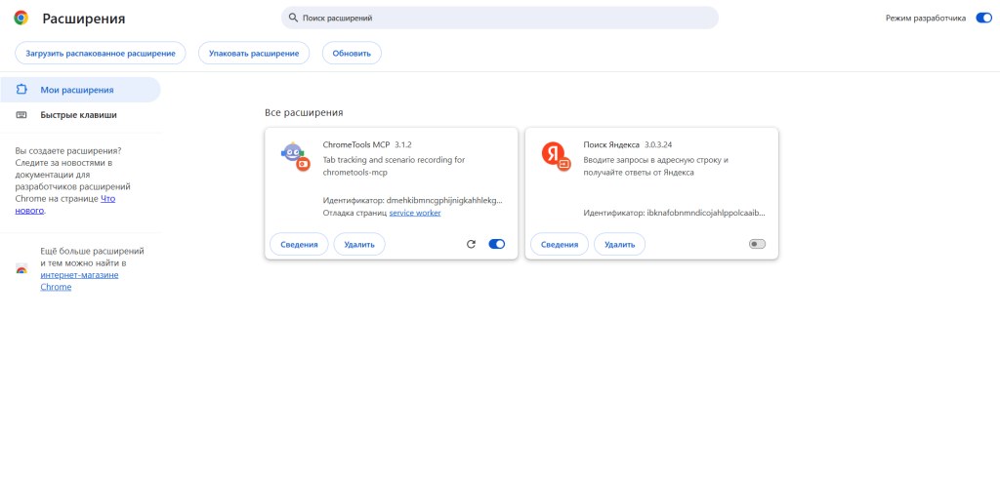

# chrometools-mcp

> 🌐 [Русская версия README](./README.ru.md)

**AI-powered Chrome automation through natural language.** No more fighting with CSS selectors, XPath expressions, or brittle test scripts. Just tell your AI assistant what you want to do on a web page, and ChromeTools MCP makes it happen.

## Why ChromeTools MCP?

**For AI Agents & Developers:**
- 🎯 **56+ specialized tools** for browser automation - from simple clicks to Figma comparisons
- 🧠 **APOM (Agent Page Object Model)** - AI-friendly page representation (~8-10k tokens vs 5-10k for screenshots)
- 🔄 **Persistent browser sessions** - pages stay open between commands for iterative workflows
- ⚡ **Framework-aware** - handles React, Vue, Angular events and state updates automatically
- 📸 **Visual testing** - compare designs pixel-by-pixel with Figma integration
- 🎬 **Scenario recording** - record browser actions, replay them, or export as Playwright/Selenium tests
- 🌍 **Cross-platform** - works seamlessly on Windows, WSL, Linux, and macOS

**Perfect for:**
- 🤖 Building AI agents that interact with web applications
- 🧪 Automated testing without writing code - let AI generate tests from scenarios
- 🔍 Web scraping and data extraction with natural language instructions
- 🎨 Design validation - compare implemented UI with Figma designs
- 🚀 Rapid prototyping - test user flows by describing them to AI
- 📊 Monitoring and health checks for web applications

Stop writing brittle automation scripts. Start describing what you want in plain English.

## Installation

### Claude Code (CLI)

The easiest way to install for Claude Code users:

```bash
claude mcp add chrometools -- npx chrometools-mcp
```

This command will automatically configure the MCP server in your Claude Code settings.

### Claude Desktop

Add to your Claude Desktop configuration file:

**macOS/Linux:** `~/Library/Application Support/Claude/claude_desktop_config.json`
**Windows:** `%APPDATA%\Claude\claude_desktop_config.json`

```json
{
  "mcpServers": {
    "chrometools": {
      "command": "npx",
      "args": ["chrometools-mcp"]
    }
  }
}
```

### Cursor

**Step 1:** Open MCP Settings in Cursor
- Click on **Settings** (⚙️ icon or `Cmd + ,` / `Ctrl + ,`)
- Navigate to **Cursor Settings** → **MCP**

**Step 2:** Edit MCP Configuration
- You'll see the MCP configuration JSON editor
- Add `chrometools` to the `mcpServers` object:

```json
{
  "mcpServers": {
    "chrometools": {
      "command": "npx",
      "args": ["chrometools-mcp"]
    }
  }
}
```

**If you already have other MCP servers configured, just add chrometools to the existing list:**

```json
{
  "mcpServers": {
    "existing-server": {
      "command": "npx",
      "args": ["some-other-mcp"]
    },
    "chrometools": {
      "command": "npx",
      "args": ["chrometools-mcp"]
    }
  }
}
```

**Step 3:** Save and Restart
- Save the configuration file
- Restart Cursor to apply changes
- The chrometools-mcp tools will now be available in Cursor Agent

**Step 4:** Test the Installation
- Open Cursor Chat
- Select **Agent** mode
- Try a command like: "Open browser and navigate to google.com"

### Google Antigravity

**Step 1:** Open Agent session in Antigravity

**Step 2:** Click the "**…**" dropdown at the top of the editor's side panel

**Step 3:** Select **"MCP Servers"** to open the MCP Store

**Step 4:** Click **"Manage MCP Servers"** at the top of the MCP Store

**Step 5:** Click **"View raw config"** in the main tab

**Step 6:** Edit `mcp_config.json` (located in `~/.gemini/antigravity/` directory):

```json
{
  "mcpServers": {
    "chrometools": {
      "command": "npx",
      "args": ["chrometools-mcp"]
    }
  }
}
```

**Step 7:** Save the file and restart Antigravity

**Note:** Antigravity has a limit of ~100 tools per session. If you have many MCP servers installed, consider reducing the number of active tools to ~25 for optimal performance.

### Other MCP Clients

For Cline, Continue, or other MCP-compatible clients, add to your MCP configuration:

```json
{
  "mcpServers": {
    "chrometools": {
      "command": "npx",
      "args": ["chrometools-mcp"]
    }
  }
}
```

### Manual Installation

You can also run directly without configuration:

```bash
npx chrometools-mcp
```

### Chrome Extension Setup

The Chrome Extension is **required** for scenario recording and other advanced features. Follow these steps to install it:

**Important:** ChromeTools opens Chrome with a separate user profile, so you must install the extension **after** ChromeTools starts Chrome for the first time.

> **Auto-loading:** when ChromeTools launches Chrome itself, it loads the extension automatically (via CDP `Extensions.loadUnpacked`, since Chrome 137+ ignores `--load-extension`). Manual installation below is only needed when ChromeTools attaches to a Chrome you started yourself without `--enable-unsafe-extension-debugging`.

**Step 1:** Start ChromeTools MCP server first
- Make sure ChromeTools is running through your MCP client (Claude Desktop, Cursor, etc.)
- Or run it manually: `npx chrometools-mcp`
- This will launch Chrome with ChromeTools' isolated profile

**Step 2:** Enable Developer Mode in Chrome
- Open Chrome Extensions page: `chrome://extensions`
- Toggle **Developer mode** (switch in top-right corner)



**Step 3:** Download and Extract the Extension

**Option A - Download from GitHub (Recommended):**
1. Download the extension archive: [chrome-extension.zip](https://github.com/docentovich/chrometools-mcp/raw/main/chrome-extension.zip)
2. Extract the ZIP file to a folder on your computer
3. Remember the extraction path (you'll need it in the next step)

**Option B - Use from node_modules (if you know the path):**
- **After npx install:** `~/.npm/_npx/.../node_modules/chrometools-mcp/extension`
- **After global install:** `<npm-global-path>/node_modules/chrometools-mcp/extension`
- **From source:** `<repo-path>/extension`

**Step 4:** Load the Extension
- Click **"Load unpacked"** button
- Navigate to the extracted extension folder (from Step 3)
- Select the folder and click **"Select Folder"**

**Step 5:** Verify Installation
- You should see "ChromeTools MCP" extension appear in your extensions list with:
  - **Name:** ChromeTools MCP
  - **Version:** (current version)
  - **Description:** MCP server integration for Chrome automation
  - **Status:** Toggle should be ON (blue)
- Look for the ChromeTools icon (CT) in your Chrome toolbar
- The extension is now ready to use for scenario recording


> **Note:** After installation, the extension card will appear on the `chrome://extensions` page alongside other installed extensions. The extension should show as "Enabled" with a blue toggle switch.

**Step 6:** Pin the Extension (Optional but Recommended)
- Click the puzzle piece icon in Chrome toolbar
- Find "ChromeTools MCP" in the list
- Click the pin icon to keep it visible in toolbar

**Troubleshooting:**
- **Recommended:** Use Option A (download from GitHub) to avoid searching in node_modules
- If using Option B and can't find the extension folder after `npx` install, run `npm list -g chrometools-mcp` to find the installation path
- The extension only works with Chrome instances launched by ChromeTools
- If Chrome closes and reopens, the extension should still be loaded (developer mode persists)
- When ChromeTools first opens Chrome, it automatically shows a prompt with the extension path in node_modules

## Table of Contents

- [Installation](#installation)
  - [Chrome Extension Setup](#chrome-extension-setup)
- [AI Optimization Features](#ai-optimization-features)
- [Scenario Recorder](#scenario-recorder) - Visual UI-based recording with smart optimization
- [Available Tools](#available-tools) - **70 Tools Total**
  - [AI-Powered Tools](#ai-powered-tools) - smartFindElement, analyzePage, getElementDetails, findElementsByText
  - [Core Tools](#1-core-tools) - ping, openBrowser
  - [Interaction Tools](#2-interaction-tools) - click, type, scrollTo, selectOption, selectFromGroup, drag, scrollHorizontal
  - [Inspection Tools](#3-inspection-tools) - getComputedCss, getFontReport, getBoxModel, screenshot, saveScreenshot
  - [Advanced Tools](#4-advanced-tools) - executeScript, getConsoleLogs, listNetworkRequests, getNetworkRequest, filterNetworkRequests, hover, pressKey, setStyles, setViewport, getViewport, navigateTo
  - [Tab Management Tools](#5-tab-management-tools) - resetBrowser, listTabs, switchTab
  - [Frame Tools](#5a-frame-tools-iframe-automation) - listFrames, switchFrame (cross-origin iframe automation)
  - [Credential Vault](#5b-credential-vault-saved-passwords) - typeCredential, listCredentials (log in without passing passwords through the AI)
  - [Figma Tools](#6-figma-tools) - getFigmaFrame, compareFigmaToElement, compareFigmaSpecs, getFigmaNodeTree, getFigmaSpecs, Figma disk cache and more
  - [Recorder Tools](#7-recorder-tools) - enableRecorder, startRecording, stopRecording, getRecorderState, saveScenario, executeScenario, listScenarios, searchScenarios, getScenarioInfo, deleteScenario, exportScenarioAsCode, appendScenarioToFile, generatePageObject
  - [API / Swagger Tools](#8-api--swagger-tools) - loadSwagger, generateApiModels
- [Typical Workflow Example](#typical-workflow-example)
- [Tool Usage Tips](#tool-usage-tips)
- [Configuration](#configuration)
- [Multi-Instance Support](#multi-instance-support) - Run multiple MCP servers simultaneously
- [WSL Setup Guide](#wsl-setup-guide) → [Full WSL Guide](WSL_SETUP.md)
- [Development](#development)
- [Features](#features)
- [Architecture](#architecture)

## AI Optimization Features

: Dramatically reduce AI agent request cycles with intelligent element finding and page analysis.

### Why This Matters

Traditional browser automation with AI requires many trial-and-error cycles:
```
AI: "Find login button"
→ Try selector #1: Not found
→ Try selector #2: Not found
→ Try selector #3: Found! (3 requests, 15-30 seconds)
```

**With AI optimization:**
```
AI: smartFindElement("login button")
→ Returns ranked candidates with confidence scores (1 request, 2 seconds)
```

### Key Features

1. **`analyzePage`** - 🔥 **USE FREQUENTLY** - Get current page state after loads, clicks, submissions (cached, use refresh:true)
2. **`smartFindElement`** - Natural language element search with multilingual support
3. **AI Hints** - Automatic context in all tools (page type, page heading, modal content, dropdown/menu items, suggestions)
4. **Text search** - `findElementsByText` for finding elements by visible text

**Performance:** 3-5x faster, 5-10x fewer requests

**Best Practice:**
- Use `analyzePage()` after page loads AND after interactions (clicks, submissions)
- Use `analyzePage({ refresh: true })` after page changes to see current state
- Prefer `analyzePage` over `screenshot` for debugging form data

📚 [Full AI Optimization Guide](AI_OPTIMIZATION.md)

## Scenario Recorder

: Visual UI-based recorder for creating reusable test scenarios with automatic secret detection.

### Features

- **Visual Widget** - Floating recorder UI with compact mode (50x50px minimize button)
- **Auto-Reinjection** - Recorder persists across page reloads/navigation automatically with duplicate prevention - **Smart Click Detection** - Finds actual clickable parent elements with event listeners- **Smart Waiters** - 2s minimum + animation/network/DOM change detection after clicks- **Detailed Error Reports** - Comprehensive failure analysis with context and suggestions- **Smart Recording** - Captures clicks, typing, navigation with intelligent optimization
- **Secret Detection** - Auto-detects passwords/emails and stores them securely
- **Action Optimization** - Combines sequential actions, removes duplicates
- **Scenario Management** - Save, load, execute, search, and delete scenarios
- **Dependencies** - Chain scenarios together with dependency resolution
- **Multi-Instance Protection** - Prevents multiple recorder instances from interfering
### Quick Start

```javascript
// 1. Enable recorder UI
enableRecorder()

// 2. Click "Start" in widget, perform actions, click "Stop & Save"
// 3. Execute saved scenario
executeScenario({ name: "login_flow", parameters: { email: "user@test.com" } })
```

📚 [Full Recorder Guide](RECORDER_QUICKSTART.md) | [Recorder Spec](RECORDER_SPEC.md)

## Available Tools

### ⚠️ Tool Usage Priority

**CRITICAL: Always use specialized tools first. Never jump to `executeScript` as first choice.**

#### For Clicking/Interaction
1. ✅ **`click()`** - PRIMARY tool for all clicks
   - Works correctly with React/Vue/Angular synthetic events
   - Handles button clicks, link navigation, form submissions
2. ✅ **`findElementsByText()` + action** - When selector is unknown, find by text
3. ⚠️ **`executeScript()`** - LAST RESORT, only if above failed

#### For Filling Forms
1. ✅ **`type()`** - PRIMARY tool for all text input
   - Properly updates React hooks, Vue reactive data
   - Auto-clears field before typing (configurable)
2. ⚠️ **`executeScript()`** - LAST RESORT, only if above failed

#### For Reading Page State
1. ✅ **`analyzePage()`** - PRIMARY tool for reading page content
   - Gets forms, inputs, buttons, links with current values
   - Use `refresh: true` after interactions to see updated state
   - Efficient: 2-5k tokens vs screenshot 5-10k
2. ✅ **`findElementsByText()`** - Find specific elements by visible text
3. ✅ **`getElementDetails()`** - Full info about one element by APOM ID (optionally with children)
4. ⚠️ **`executeScript()`** - LAST RESORT, only if above failed

#### Model-Based Interaction (Advanced)
1. ✅ **`executeModelAction()`** - Universal tool for model-specific actions
   - Works with element models (Strategy Pattern)
   - Supports both APOM ID and CSS selector
   - Framework-specific actions (e.g., DatePicker SetDate, Checkbox toggle)
   - Example: `executeModelAction({id: "input_34", action: "check"})`
   - Example: `executeModelAction({selector: ".datepicker", action: "SetDate", params: {date: "2024-03-15"}})`
   - See `models/` directory for available models and actions
   - Available models: TxtInp, Sel, Btn, Chk, Radio, TxtArea, Link, Range, DatePicker, DateInp, FileInp, ColorInp, **Modal**, default

#### Modal/Dialog Support
- **Automatic detection**: APOM detects modals rendered via React Portals (antd, MUI, Bootstrap, Chakra, Mantine, Element UI, Headless UI, Radix)
- **Detection methods**: `role="dialog"`, `aria-modal="true"`, framework-specific CSS classes
- **Animation-proof**: Modal elements are included even during CSS appear animations (opacity: 0)
- **Rich metadata**: Modal nodes include `title` and `actions` (button labels) in metadata
- **In APOM tree**: Modals appear as `type: "dialog"` with `model: "Modal"`, containing all interactive children

**Why specialized tools matter:**
- ✅ Trigger proper browser events (click, input, change)
- ✅ Work with React/Vue/Angular synthetic event systems
- ✅ Update framework state correctly (React hooks, Vue reactivity)
- ✅ Handle animations, navigation, and async updates
- ❌ `executeScript` bypasses framework events and may fail silently

### AI-Powered Tools

#### smartFindElementFind elements using natural language descriptions instead of CSS selectors.
- **Parameters**:
  - `description` (required): Natural language (e.g., "login button", "email field")
  - `maxResults` (optional): Max candidates to return (default: 5)
  - `minConfidence` (optional): Confidence threshold (0–1, default **0.6**) for auto-executing `action`. If the best match scores below this — or is too close to the runner-up — the action is **skipped** and candidates are returned with an `actionSkipped` reason instead. Prevents auto-clicking the wrong control (e.g. a primary form submit when you asked for a menu item). Lower it to act on weaker matches.
- **Candidate coverage**: besides `button`/`input`/`a`/`[role=button]`, also considers `[onclick]`, `[role=menuitem]`, `[role=tab]`, and links inside `nav`/`[role=navigation]`/`[role=menu]` — so menu items rendered as `div`/`span[onclick]` are found. Scoring penalizes candidates whose text doesn't match the description and rewards navigation/menu context.
- **Use case**: When you don't know the exact selector
- **Returns**: Ranked candidates with confidence scores, selectors, and reasoning
- **Example**:
  ```json
  {
    "description": "submit button",
    "maxResults": 3
  }
  ```
  Returns:
  ```json
  {
    "candidates": [
      { "selector": "button.login-btn", "confidence": 0.95, "text": "Login", "reason": "type=submit, in form, matching keyword" },
      { "selector": "#submit", "confidence": 0.7, "text": "Send", "reason": "submit class" }
    ],
    "hints": { "suggestion": "Use selector: button.login-btn" }
  }
  ```

#### analyzePage Get current page state and structure. Returns complete map of forms (with values), inputs, buttons, links with selectors.

**Interactivity Detection**:
- Detects interactive elements via **8 different methods**:
  1. Native HTML tags (`button`, `a`, `input`, `select`, `textarea`)
  2. ARIA roles (`button`, `link`, `checkbox`, etc.)
  3. `onclick` attribute
  4. `onclick` property (set via JavaScript)
  5. CSS `cursor: pointer`
  6. JavaScript `addEventListener('click')`
  7. `tabindex` attribute (except -1)
  8. `contenteditable="true"`
- **Captures DIV/SPAN with click handlers** - JavaScript-enabled elements are detected
- Adds `interactivityReason` metadata showing detection method (e.g., `cursor-pointer`, `event-listener`)

**When to use**:
  - After opening/navigating to page (initial analysis)
  - **After clicking buttons** (see what changed)
  - **After form submissions** (check results, errors)
  - **After AJAX updates** (dynamic content loaded)
  - When debugging (see actual form values, not just visual)
  - **Layout/styling work** - use `includeAll: true` to get ALL page elements with selectors
- **Parameters**:
  - `refresh` (optional): Force refresh cache to get CURRENT state after changes (default: false)
  - `includeAll` (optional): Include ALL page elements, not just interactive ones (default: false). Useful for layout work - find any element, get its selector, then use `getComputedCss` or `setStyles` on it.
  - `useLegacyFormat` (optional): Return legacy format instead of APOM (default: false - APOM is the default)
  - `registerElements` (optional): Auto-register elements for ID-based usage (default: true)   - `groupBy` (optional): 'type' or 'flat' - how to group elements (default: 'type')
  - `includePortals` (optional): Include contents of React Portal containers — menus, tooltips, popovers rendered outside the main React root (default: `true`). Without this, items inside dropdown popups (e.g. action menus in MTS-like apps) are invisible to `analyzePage`.
  - `portalSelectors` (optional): Array of CSS selectors for portal root containers. Default: `['#modal-root', '#menu-popup-root', '#tooltip-root', '#popover-root', '[data-portal]']`. Override when the app uses different portal element ids.
  - **In-tree popup heuristic**: when `includePortals` is enabled (default), `analyzePage` also detects "in-tree portal" patterns — popups rendered inside a 0-height inline wrapper and absolute-positioned out of it (Popper, Tippy, FloatingUI, custom contextMenu implementations). Without this, popup items live inside an `offsetHeight: 0` wrapper that `isVisible` drops, making the whole popup subtree invisible to `analyzePage`. - **Why better than screenshot**:
  - Shows actual data (form values, validation errors) not just visual
  - Uses 2-5k tokens vs screenshot 5-10k tokens
  - Returns structured data with **unique element IDs** for easy interaction
  - **Detects UI frameworks** (MUI, Ant Design, Chakra, Bootstrap, Vuetify, Semantic UI)  - **Extracts dropdown options** from both native `<select>` and custom UI components- **Returns**:
  - **APOM format** (default): Tree-structured Page Object Model with unique IDs     - `tree` - Hierarchical tree of page elements (optimized: ~82% smaller than flat format)
      - Each node: `{ tag, id?, type?, sel, ch?, bounds?, meta? }`
      - Interactive elements have `bounds` and full metadata
      - Parent containers have minimal info (position only)
    - `groups` - Radio/checkbox groups with options (name, value, label, checked state)
    - `meta` - Page metadata (url, title, timestamp, element counts)
    - Elements automatically registered - use IDs with `click({ id: "..." })`, `type({ id: "..." })`, etc.
    - **Token-optimized**: Minified JSON, simplified parents, no redundant data
    - Example: `analyzePage()` returns APOM, then use `click({ id: "button_45" })` or `type({ id: "input_20", text: "..." })`
  - **Use `getElementDetails({ id: "input_20" })`** to get full details for any element, or with `analyzeChildren: true` to get children tree structure
  - **Legacy format** (`useLegacyFormat: true`): Classic format for backward compatibility
    - Complete map of forms (with current values), inputs, buttons, links, navigation with selectors
    - **Each element includes `uiFramework` info** (name, version, component type)    - **Select elements include `options` array** with value, text, index, selected, disabled, group    - With `includeAll: true`: Also includes `allElements` array with ALL visible page elements (divs, spans, headings, etc.) - each with selector, tag, text, classes, id
- **Example workflow**:
  1. `openBrowser({ url: "..." })`
  2. `analyzePage()` ← Initial analysis, returns elements with IDs
  3. `type({ id: "input_20", text: "user@example.com" })` ← Use APOM ID
  4. `click({ id: "button_45" })` ← Use APOM ID
  5. **`analyzePage({ refresh: true })`** ← See what changed after click!
- **Layout work example**:
  1. `analyzePage({ includeAll: true })` ← Get all elements
  2. Find element you want to style (e.g., `div.header`)
  3. `getComputedCss({ selector: "div.header" })` ← Get current styles
  4. `setStyles({ selector: "div.header", styles: [...] })` ← Apply new styles

#### getElementDetailsGet comprehensive details about a specific element by its APOM ID. Can optionally analyze children elements tree structure. Use when `analyzePage` output is simplified and you need complete element information or want to focus analysis on a specific section.
- **Parameters**:
  - `id` (required): APOM element ID (e.g., `"input_20"`, `"button_45"`)
  - `analyzeChildren` (optional): Analyze children elements tree structure (default: false)
  - `includeAll` (optional): When analyzing children, include all elements, not just interactive ones (default: false)
  - `refresh` (optional): Force refresh of cached analysis (default: false)
- **Use case**:
  - Get full details including bounds, CSS selector, attributes, computed styles
  - Focus analysis on specific section (modal, form, sidebar, etc.) with `analyzeChildren: true`
- **Returns**: Complete element details including:
  - `id`: Element APOM ID
  - `selector`: CSS selector for the element
  - `tag`: HTML tag name
  - `type`: Element type (input, button, link, etc.)
  - `text`: Visible text content
  - `bounds`: Position and size `{ x, y, width, height, top, right, bottom, left }`
  - `attributes`: All HTML attributes (id, class, name, placeholder, href, etc.)
  - `computed`: Key CSS properties (display, visibility, cursor, color, fontSize, etc.)
  - `metadata`: Element metadata from APOM analysis
  - `visible`: Whether element is visible
  - `childrenTree` (optional): APOM tree structure of children elements when `analyzeChildren: true`
- **Example**:
  ```javascript
  // Get complete details for specific input field
  getElementDetails({ id: "input_20" })

  // Returns:
  {
    "success": true,
    "id": "input_20",
    "selector": "input[name='email']",
    "tag": "input",
    "type": "email",
    "text": "",
    "bounds": { "x": 100, "y": 200, "width": 300, "height": 40, "top": 200, "right": 400, "bottom": 240, "left": 100 },
    "attributes": { "name": "email", "placeholder": "Enter email", "type": "email" },
    "computed": { "display": "block", "visibility": "visible", "cursor": "text" },
    "visible": true
  }

  // Analyze modal contents after opening it
  analyzePage() // Get initial page structure
  click({ id: "button_45" }) // Open modal
  getElementDetails({ id: "container_123", analyzeChildren: true, refresh: true }) // Analyze modal contents with children tree
  ```

#### findElementsByText
Find elements by their visible text content.
- **Parameters**:
  - `text` (required): Text to search for
  - `exact` (optional): Exact match only (default: false)
  - `caseSensitive` (optional): Case sensitive search (default: false)
- **Returns**: Elements containing the text with their selectors

### 1. Core Tools

#### ping
Test MCP connection with a simple ping-pong response.
- **Parameters**: `message` (optional)
- **Example**: `{ "name": "ping", "arguments": { "message": "hello" } }`
- **Returns**: `pong: hello`

#### openBrowser
Opens browser and navigates to URL. Browser stays open for further interactions.
- **Parameters**: `url` (required)
- **Use case**: First step before other tools
- **Returns**: Page title + confirmation

### 2. Interaction Tools

#### click
Click an element with optional result screenshot. **PREFERRED**: Use APOM ID from `analyzePage` for reliable targeting.
- **Parameters**:
  - `id` (optional): APOM element ID from analyzePage (e.g., `"button_45"`, `"link_7"`). **Preferred over selector.**
  - `selector` (optional): CSS selector. Use when APOM ID is not available.
  - ⚠️ Either `id` OR `selector` required (mutually exclusive)
  - `waitAfter` (optional): Wait time in ms (default: 1500)
  - `screenshot` (optional): Capture screenshot (default: false for performance) ⚡
  - `timeout` (optional): Max operation time in ms (default: 30000)
  - `skipNetworkWait` (optional): Skip waiting for network requests (default: false). **Use for pages with continuous long-polling to get instant response.**
  - `networkWaitTimeout` (optional): Custom network wait timeout in ms (default: 10000). Only used if skipNetworkWait is false.
  - `waitForSelector` (optional): CSS selector to wait for **after** the click — atomic click+wait. Use for dropdowns/popups that render into a React Portal and otherwise race with the next MCP call. Example: `click({ id: 'button_47', waitForSelector: '#menu-popup-root > div' })`.
  - `waitTimeoutMs` (optional): Timeout for `waitForSelector` in ms (default: 2000). On timeout the click still succeeds but the result text reports `⚠️ WAIT_TIMEOUT`.
  - `waitForRouteChange` (optional): For SPAs (React Router etc.). After the click, waits for `location.pathname + location.search` to change relative to before, then reports `Route changed: "/a" → "/b"` or `⚠️ ROUTE_UNCHANGED`. Because SPAs navigate via `history.pushState`, plain network diagnostics may not register the navigation — this makes "success" mean the view actually changed, not just that the click was delivered. Never fails the click on timeout. For view changes that don't alter the URL, use `waitForSelector` instead.
  - `autoAnalyzeAfter` (optional): After click, automatically diff APOM and append the delta to the result text (e.g. `+3 appeared: button_42:"Статистика", button_43:"Настройки", link_44:"Удалить"`). New element ids are pre-registered so the next `click({ id })`/`type({ id })` call works **without an extra `analyzePage`**. Designed for the dropdown/menu pattern: one MCP call instead of three.
- **Use case**: Buttons, links, form submissions, Django admin forms
- **Returns**: Confirmation text + optional screenshot + network diagnostics
- **Performance**: 2-10x faster without screenshot, instant with skipNetworkWait
- **Click strategy**: Three-tier fallback for maximum compatibility:
  1. Puppeteer native click (trusted CDP events)
  2. CDP coordinate click at element center (trusted, bypasses interception check)
  3. JavaScript `element.click()` (untrusted, last resort)
- **Covered elements**: when another element is on top of the target at its center, the result says what covers it: `[dom-sequence-intercepted: element covered by div#cover ...]`. Extra warnings when the cover is a dev-server error overlay or when the target is behind an open modal (usually a duplicate element under the dialog was matched).
- **No-effect check**: `⚠️ NO_CHANGE` when the click caused no DOM change outside the element, no state attribute change (`aria-*`, `checked`, `value`), no URL change and no data request.
- **Example**:
  ```javascript
  // PREFERRED: Using APOM ID
  click({ id: "button_45" })

  // Alternative: Using CSS selector
  click({ selector: "button[type='submit']" })

  // Django forms with WebSockets (prevents timeout)
  click({ selector: ".submit-row input[type='submit']", skipNetworkWait: true })

  // Custom network timeout for slow APIs
  click({ id: "save_btn", networkWaitTimeout: 10000 })
  ```

#### type
Type text into input fields with optional clearing and typing delay. **PREFERRED**: Use APOM ID from `analyzePage` for reliable targeting.
- **Parameters**:
  - `id` (optional): APOM element ID from analyzePage (e.g., `"input_20"`). **Preferred over selector.**
  - `selector` (optional): CSS selector. Use when APOM ID is not available.
  - ⚠️ Either `id` OR `selector` required (mutually exclusive)
  - `text` (required): Text to type
  - `delay` (optional): Delay between keystrokes in ms (default: 30)
  - `clearFirst` (optional): Clear field first (default: true)
  - `timeout` (optional): Max operation time in ms (default: 30000). **Prevents infinite hangs on Django forms.**
- **Use case**: Filling forms, search boxes, text inputs, Django admin forms
- **Returns**: Confirmation text
- **Example**:
  ```javascript
  // PREFERRED: Using APOM ID
  type({ id: "input_20", text: "user@example.com" })

  // Alternative: Using CSS selector
  type({ selector: "input[name='email']", text: "user@example.com" })
  ```

#### scrollTo
Scroll page to bring element into view.
- **Parameters**:
  - `selector` (required): CSS selector
  - `behavior` (optional): "auto" or "smooth"
- **Use case**: Lazy loading, sticky elements, visibility checks
- **Returns**: Final scroll position

#### selectOption
Select option in dropdown (HTML select elements). **PREFERRED**: Use APOM ID from `analyzePage` for reliable targeting.
- **Parameters**:
  - `id` (optional): APOM element ID from analyzePage (e.g., `"select_5"`). **Preferred over selector.**
  - `selector` (optional): CSS selector. Use when APOM ID is not available.
  - ⚠️ Either `id` OR `selector` required (mutually exclusive)
  - `value` (optional): Option value attribute (priority 1)
  - `text` (optional): Option text content (priority 2)
  - `index` (optional): Option index, 0-based (priority 3)
- **Use case**: Form dropdowns, filtering, selection menus
- **Returns**: Selected option details (value, text, index)
- **Selection priority**: If multiple parameters specified, tries value → text → index
- **AI Integration**: Use `analyzePage` to see all available options with their values, text, and indices
- **Example**:
  ```javascript
  // PREFERRED: Using APOM ID
  selectOption({ id: "select_5", value: "US" })

  // Alternative: Using CSS selector
  selectOption({ selector: "select[name='country']", text: "United States" })
  ```

#### selectFromGroupSelect option(s) from radio or checkbox group by name attribute. Works at abstract group level instead of individual clicks.
- **Parameters**:
  - `name` (required): Name attribute of the radio/checkbox group (e.g., 'size', 'toppings')
  - `value` (optional): Single value to select (for radio or single checkbox)
  - `values` (optional): Array of values to select (for checkbox group)
  - `text` (optional): Label text to match (alternative to value)
  - `texts` (optional): Array of label texts to match (for checkbox group)
  - `by` (optional): Match by 'value', 'text', or 'auto' (default: 'auto')
  - `mode` (optional): For checkboxes - 'set' (replace all), 'add', 'remove', 'toggle' (default: 'set')
- **Use case**: Radio buttons, checkbox groups, form options
- **Returns**: Result with changes made and current selection state
- **AI Integration**: Use `analyzePage` to see available groups in `groups` section with all options and labels
- **Examples**:
  ```javascript
  // Radio group - select single option
  selectFromGroup({ name: "size", value: "large" })
  selectFromGroup({ name: "size", text: "Extra Large" })

  // Checkbox group - set specific values (uncheck others)
  selectFromGroup({ name: "toppings", values: ["cheese", "bacon"] })

  // Checkbox group - add to existing selection
  selectFromGroup({ name: "toppings", values: ["mushrooms"], mode: "add" })

  // Checkbox group - remove specific values
  selectFromGroup({ name: "toppings", values: ["onions"], mode: "remove" })

  // Checkbox group - toggle values
  selectFromGroup({ name: "toppings", texts: ["Extra Cheese"], mode: "toggle" })
  ```

#### drag
Drag element by mouse (click-hold-move-release). Simulates real mouse drag, not scrollbar scrolling.
- **Parameters**:
  - `selector` (required): CSS selector for element to drag
  - `direction` (required): 'up', 'down', 'left', 'right', 'up-left', 'up-right', 'down-left', 'down-right'
  - `distance` (optional): Distance in pixels (default: 100)
  - `duration` (optional): Drag duration in milliseconds (default: 500)
  - `mode` (optional): 'native' (default) or 'synthetic'
    - **'native'**: Uses Puppeteer mouse API - faster, works for most cases
    - **'synthetic'**: Dispatches DOM events (pointerdown/pointermove/pointerup) - better compatibility with JS libraries (frappe-gantt, jQuery UI Draggable, custom drag handlers)
- **Use case**: Interactive maps (Google Maps, Leaflet), Gantt charts, SVG diagrams, canvas elements, sliders, drag-to-pan interfaces
- **How it works**:
  - **Native mode**: Uses Puppeteer's mouse API (mousedown → mousemove → mouseup)
  - **Synthetic mode**: Dispatches PointerEvent/MouseEvent on element with intermediate pointermove events during drag
- **When to use synthetic mode**: If native drag doesn't trigger JS library event handlers (e.g., frappe-gantt, jQuery UI, React DnD)
- **NOT for**: Standard overflow scrollbars (use `scrollTo` or `scrollHorizontal` instead)
- **Returns**: Start/end mouse positions, drag delta, and mode used

#### scrollHorizontal
Scroll element horizontally (for tables, carousels, wide content).
- **Parameters**:
  - `selector` (required): CSS selector for element to scroll
  - `direction` (required): 'left' or 'right'
  - `amount` (required): Number of pixels to scroll, or 'full' to scroll to the end
  - `behavior` (optional): 'auto' or 'smooth' (default: 'auto')
- **Use case**: Wide tables, image carousels, horizontally scrollable containers
- **Returns**: Scroll state (position, total width, visible width, scroll availability)

### 3. Inspection Tools

#### getComputedCss
Get computed CSS styles for an element with intelligent filtering to reduce token usage.
- **Parameters**:
  - `selector` (optional): CSS selector (defaults to body)
  - `category` (optional): Filter by category - 'layout', 'typography', 'colors', 'visual', or 'all' (default)
  - `properties` (optional): Array of specific properties to return (e.g., `['color', 'font-size']`) - overrides category filter
  - `includeDefaults` (optional): Include properties with default values (default: false)
- **Use case**: Debugging layout, verifying styles, design comparison
- **Returns**: JSON object with filtered CSS properties, metadata about filtering
- **Performance**: Without filters returns ~300 properties (~14k tokens). With filtering returns 10-50 properties (~1-2k tokens)
- **Example usage**:
  - Layout only: `{ selector: ".header", category: "layout" }`
  - Specific properties: `{ selector: ".title", properties: ["color", "font-size", "font-weight"] }`
  - Typography without defaults: `{ selector: "h1", category: "typography", includeDefaults: false }`
- **Batch mode**: `selectors` (array, up to 50) + `properties` (or `category`; default: font-family, font-size, font-weight, line-height, letter-spacing, color, background-color, width, height, padding, gap, border-radius, border). `all: true` takes every match of each selector (max 100 elements). One call returns a table: `{ props, rows: [{ sel, i, box: [x, y, w, h], values }], notFound }`
  - Example: `{ selectors: ["td", "th", "a.link", ".pagination"], all: true, properties: ["font-size", "line-height", "color"] }`

#### getFontReport
Which fonts are actually rendered. Computed style shows only the declared `font-family`; this tool asks Chrome which font it used (CDP `CSS.getPlatformFontsForNode`).
- **Parameters**: `selector` (default `body`), `maxElements` (default 300)
- **Returns**: per declared family + weight: the rendered font and its status: `web font`, `system font`, or `FALLBACK` (the web font did not load or lacks the weight); element count, sizes, examples. Plus `document.fonts` with load status and the list of failed `@font-face`
- **Example output**: `declared "MTS Compact" 400 -> rendered "Arial" (FALLBACK): 120 element(s), sizes 14px, e.g. td.cell`
- **Note**: main frame only

#### getBoxModel
Get precise dimensions, positioning, margins, padding, and borders.
- **Parameters**: `selector` (required)
- **Use case**: Pixel-perfect measurements, layout analysis
- **Returns**: Box model data + metrics

#### screenshot
Capture optimized screenshot of a specific element, or the full viewport when no `id`/`selector` is given. Smart compression with a 3 MB hard limit.
- **Parameters**:
  - `id` (optional): APOM element ID from `analyzePage`. Mutually exclusive with `selector`.
  - `selector` (optional): CSS selector. Mutually exclusive with `id`.
  - Omit both `id` and `selector` to capture the **full viewport** (no element resolution needed).
  - `padding` (optional): Padding in pixels (default: 0). Ignored for viewport screenshots.
  - `maxWidth` (optional): Max width for auto-scaling (default: 1024, null for original size)
  - `maxHeight` (optional): Max height for auto-scaling (default: 8000, null for original size)
  - `quality` (optional): JPEG quality 1-100 (default: 40)
  - `format` (optional): 'png', 'jpeg', or 'auto' (default: 'jpeg')
- **Use case**: Visual documentation, bug reports
- **Returns**: Optimized image with metadata (~5-10k tokens)
- **Default behavior**: JPEG at quality 40, auto-scales to 1024px width and 8000px height (API limit). For higher quality, explicitly set `quality` and `format` parameters
- **Automatic compression**: If image exceeds 3 MB, automatically reduces quality or scales down to fit within limit
- **For original quality**: Set `maxWidth: null`, `maxHeight: null` and `format: 'png'` (still enforces 3 MB limit)

#### saveScreenshot
Save optimized screenshot of an element or of the viewport to filesystem without returning in context, with automatic 3 MB limit.
- **Parameters**:
  - `selector` (optional): CSS selector of the element. Required unless `viewport: true`
  - `viewport` (optional): capture exactly the visible viewport (`innerWidth x innerHeight`, scrollbars included)
  - `excludeScrollbar` (optional): with `viewport: true`, capture `documentElement.clientWidth x clientHeight` (no scrollbars)
  - `hideSelectors` (optional): elements hidden for the shot (chat widget, cookie banner)
  - `clip` (optional): `{ x, y, width, height }` area in CSS px relative to the viewport
  - `scale` (optional): `'device'` (default, image px = CSS px x devicePixelRatio) or `'css'` (1 image px = 1 CSS px at any DPR)
  - `filePath` (required): Absolute path to save file
  - `padding` (optional): Padding in pixels (default: 0)
  - `maxWidth` (optional): Max width for auto-scaling (default: 1024, null for original)
  - `maxHeight` (optional): Max height for auto-scaling (default: 8000, null for original)
  - `quality` (optional): JPEG quality 1-100 (default: 80)
  - `format` (optional): 'png', 'jpeg', or 'auto' (default: 'auto')
- **Use case**: Baseline screenshots, file storage (higher quality defaults than `screenshot` tool)
- **Pixel checks**: `saveScreenshot({ viewport: true, maxWidth: null, maxHeight: null, format: 'png' })` gives an image of exactly the viewport size. The requested viewport (`setViewport`) is re-applied before the capture.
- **Returns**: File path, final size, captured area in CSS px and DPR. Warns when the image was scaled by `maxWidth`/`maxHeight`
- **Default behavior**: Auto-scales and compresses to save disk space
- **Automatic compression**: If image exceeds 3 MB, automatically reduces quality or scales down to fit within limit

### 4. Advanced Tools

#### executeScript
Execute arbitrary JavaScript in page context with optional screenshot.
- **Parameters**:
  - `script` (required): JavaScript code
  - `waitAfter` (optional): Wait time in ms (default: 500)
  - `screenshot` (optional): Capture screenshot (default: false for performance) ⚡
  - `timeout` (optional): Max operation time in ms (default: 30000)
- **Use case**: Complex interactions, custom manipulations
- **Returns**: Execution result + optional screenshot
- **Performance**: 2-10x faster without screenshot
- **Top-level `return`**: any snippet using a top-level `return` (e.g. `return document.title`, `const x = 1; return x`, or code that contains a `function` in a callback) just works — it's run as-is first, and only re-wrapped in an async IIFE if the engine reports an "Illegal return statement". Bare expressions like `document.title` still return their value. No manual `(() => { ... })()` wrapping needed.
- **Top-level `await`**: `await fetch('/api').then(r => r.json())` returns its value; multi-statement code with `await` runs inside an async function (use `return` to get a value, the result hints about it).
- **Frames**: runs inside the active frame after `switchFrame` (see [Frame Tools](#5a-frame-tools-iframe-automation)); defaults to the main frame.
- **outputFile** (optional, absolute path): write the result to a file instead of the response (the response has only the path and size). For executeScript the result value is stored as JSON. Also available on `analyzePage`, `getComputedCss`, `screenshot` (image bytes), `getFontReport`, `getFigmaNodeTree`. Written after password redaction

#### getConsoleLogs
Retrieve browser console logs (log, warn, error, etc.).
- **Parameters**:
  - `types` (optional): Array of log types to filter
  - `clear` (optional): Clear logs after reading (default: false)
- **Use case**: Debugging JavaScript errors, tracking behavior
- **Returns**: Array of log entries with timestamps

#### Network Monitoring (3 specialized tools)

**Auto-captures across page navigations**. All network requests are monitored automatically.

##### listNetworkRequests
Get compact summary of network requests with **pagination support** - minimal token usage.
- **Parameters**:
  - `types` (optional): Array of request types (default: `['Fetch', 'XHR']`)
  - `status` (optional): Filter by status (pending, completed, failed, all)
  - `limit` (optional): Maximum number of requests to return (default: 50, max: 500)
  - `offset` (optional): Number of requests to skip (default: 0)
  - `clear` (optional): Clear requests after reading (default: false)
- **Returns**: Object with `totalCount`, `returnedCount`, `hasMore`, `offset`, `limit`, and paginated `requests` array
- **Use case**: Quick overview of API calls with pagination for large request lists
- **Example**:
  - `listNetworkRequests()` → first 50 requests
  - `listNetworkRequests({ limit: 20, offset: 20 })` → requests 21-40
  - Response: `{ totalCount: 150, returnedCount: 50, hasMore: true, offset: 0, limit: 50, requests: [...] }`

##### getNetworkRequest
Get full details of a single request by ID.
- **Parameters**:
  - `requestId` (required): Request ID from listNetworkRequests
- **Returns**: Complete request/response with headers, payload, timing, mime type
- **Use case**: Deep dive into specific request after identifying it in list
- **Example**: `getNetworkRequest({ requestId: "123" })` → full details with headers, body, timing

##### filterNetworkRequests
Filter requests by URL pattern with full details.
- **Parameters**:
  - `urlPattern` (required): URL pattern (regex or partial match)
  - `types` (optional): Array of request types (default: `['Fetch', 'XHR']`)
  - `clear` (optional): Clear requests after reading (default: false)
- **Returns**: Array of full request details matching pattern
- **Use case**: Get all API calls to specific endpoint with complete data
- **Example**: `filterNetworkRequests({ urlPattern: "api/users" })` → all requests to /api/users with full details

**Workflow**:
1. `listNetworkRequests()` - see all requests (compact)
2. `getNetworkRequest({ requestId: "..." })` - inspect specific request
3. `filterNetworkRequests({ urlPattern: "api/..." })` - get all matching requests with details

#### hover
Simulate mouse hover over element. **PREFERRED**: Use APOM ID from `analyzePage` for reliable targeting.
- **Parameters**:
  - `id` (optional): APOM element ID from analyzePage (e.g., `"button_10"`). **Preferred over selector.**
  - `selector` (optional): CSS selector. Use when APOM ID is not available.
  - ⚠️ Either `id` OR `selector` required (mutually exclusive)
- **Use case**: Testing hover effects, tooltips, dropdown menus
- **Returns**: Confirmation text
- **Example**:
  ```javascript
  // PREFERRED: Using APOM ID
  hover({ id: "button_10" })

  // Alternative: Using CSS selector
  hover({ selector: ".dropdown-trigger" })
  ```

#### pressKey
Press keyboard key, optionally on a specific element. Uses Puppeteer's trusted keyboard events.
- **Parameters**:
  - `id` (optional): APOM element ID to focus before pressing
  - `selector` (optional): CSS selector to focus before pressing
  - `key` (required): Key to press — `'Enter'`, `'Escape'`, `'Tab'`, `'ArrowUp'`, `'ArrowDown'`, `'ArrowLeft'`, `'ArrowRight'`, `'Backspace'`, `'Delete'`, `'Home'`, `'End'`, `'PageUp'`, `'PageDown'`, `'Space'`
  - `modifiers` (optional): Array of modifier keys to hold — `['Control']`, `['Shift']`, `['Alt']`, `['Meta']`
  - Neither `id` nor `selector` is required — without them, presses on whatever is currently focused
- **Use case**: Form submission (Enter), closing dialogs (Escape), focus navigation (Tab), keyboard shortcuts (Ctrl+A)
- **Returns**: Confirmation text
- **Example**:
  ```javascript
  // Submit form by pressing Enter on input
  pressKey({ id: "input_20", key: "Enter" })

  // Close modal with Escape (no element needed)
  pressKey({ key: "Escape" })

  // Select all text with Ctrl+A
  pressKey({ id: "input_5", key: "a", modifiers: ["Control"] })

  // Navigate with Tab
  pressKey({ key: "Tab" })
  ```

#### setStyles
Apply inline CSS styles to element for live editing.
- **Parameters**:
  - `selector` (required)
  - `styles` (required): Array of {name, value} pairs
- **Use case**: Testing design changes, rapid prototyping
- **Returns**: Applied styles confirmation

#### setViewport
Change viewport dimensions for responsive testing.
- **Parameters**:
  - `width` (required): 320-4000px
  - `height` (required): 200-3000px
  - `deviceScaleFactor` (optional): 0.5-3 (default: 1)
- **Use case**: Testing mobile, tablet, desktop layouts
- **matchFigmaFrame** (optional): `{ fileKey, nodeId }` or `{ figmaSpecPath }`: width/height = size of the Figma frame (tree from the cache, else one request). `deviceScaleFactor` still applies
- **OS scaling**: with Windows display scaling (e.g. 110%) emulation does not give exact px: a 1px border renders as 0.909px, sizes may be 1px off (904 -> 905). The result says so (measured with a 1px probe). For exact px: Windows scaling 100%, or Chrome started with `--force-device-scale-factor=1` (Chrome launched by chrometools: `CHROMETOOLS_FORCE_DEVICE_SCALE_FACTOR=1` in the MCP env)
- **Persistence**: the requested size is kept for the session. It is re-applied after `navigateTo`/`openBrowser`, on new tabs and before screenshots; tool output says when it had to be re-applied.
- **Returns**: Actual viewport dimensions, warning when they differ from the requested ones (e.g. browser zoom not 100%)

#### getViewport
Get current viewport size and device pixel ratio.
- **Parameters**: None
- **Use case**: Checking current screen dimensions
- **Returns**: Viewport metrics (width, height, DPR)

#### navigateTo
Navigate to different URL while keeping browser instance.
- **Parameters**:
  - `url` (required)
  - `waitUntil` (optional): load event type
- **Use case**: Moving between pages in workflow
- **SPA routes**: after `goto` it waits until `document.title` and the DOM are stable (max 2 s, `CHROMETOOLS_SPA_SETTLE_MS`), so hash routes report the new title; `(unchanged after navigation)` marks a title equal to the previous one.
- **Diagnostics**: console errors with text and stack (uncaught errors included), dev-server error overlays (webpack, Vite, Next.js, CRA, Parcel) reported as `🔴 Dev error overlay covers the page`.
- **Returns**: New page title. The post-navigation network summary lists only **XHR/Fetch** requests (static assets — JS chunks, CSS, fonts, images — are hidden and counted) and is capped at the first 12 with a `… N more` note, so a heavy SPA load doesn't bury the signal.
- **Note**: resets the active frame back to the main frame (see [Frame Tools](#5a-frame-tools-iframe-automation)).

### 5. Tab Management Tools

**Which tab tools use**: the active chrometools tab. Tabs the user opens or clicks in the same Chrome do not take over; only popups / `target=_blank` tabs opened from a chrometools page, and explicit `switchTab`. When the active tab changes, the next tool result ends with `[Active tab: <url>]`. `switchTab` returns `success: false` when it could not attach to the tab (instead of `puppeteerConnected: false`). 
Tools for managing multiple browser tabs. New tabs opened via `window.open()`, `target="_blank"`, or user actions are automatically detected and tracked.

#### resetBrowser
Recover without restarting the MCP server when the tab is lost ("Attempted to use detached Frame"): forgets tracked pages and the CDP connection. Chrome and its tabs stay open.
- **Parameters**: `url` (optional): open this page right after the reset
- **Usually not needed**: before every tool the active tab is checked. A dead tab (closed, discarded, reconnected) is re-attached to an open tab with the same URL (`[Previous tab connection was lost; re-attached ...]` in the output); without such a tab the error says to call `navigateTo` / `openBrowser`, which open a new tab. A call that hits a tab dying at that moment is retried once

#### listTabs
List browser tabs. With the extension connected the browser may be the user's own Chrome, so by default only tabs chrometools works with are listed.
- **Parameters**: `all` (optional): also list the user's other tabs (URL only, no titles)
- **Returns**:
  - `tabs`: Array of `{ index, url, title, isActive, chrometools }` (`index` is what `switchTab` takes)
  - `hiddenTabs`: number of the user's tabs not listed
  - `totalCount`: Number of open tabs
  - `newTabsDetected` (optional): Array of tabs opened since last check
- **Use case**: See all open tabs, check for newly opened tabs

```javascript
// Example response
{
  "tabs": [
    { "index": 0, "url": "https://example.com", "title": "Example", "isActive": false },
    { "index": 1, "url": "https://google.com", "title": "Google", "isActive": true }
  ],
  "totalCount": 2,
  "newTabsDetected": [
    { "timestamp": "2026-01-25T...", "url": "https://google.com", "openerUrl": "https://example.com" }
  ]
}
```

#### switchTab
Switch to a different browser tab by index or URL pattern.
- **Parameters**:
  - `tab` (required): Tab index (number, 0-based) or URL pattern (string, partial match)
- **Use case**: Switch between tabs for multi-tab workflows
- **Returns**: `{ success, switchedTo: { url, title } }`

```javascript
// Switch by index
switchTab({ tab: 0 })

// Switch by URL pattern
switchTab({ tab: "google.com" })
```

### 5a. Frame Tools (iframe automation)

Tools for automating pages whose UI lives inside an `<iframe>` — including **cross-origin** iframes (e.g. a widget hosted on a different subdomain). Cross-origin frames can't be reached from page JavaScript (Same-Origin Policy blocks `iframe.contentDocument`), but ChromeTools resolves them over CDP, so the SOP doesn't apply.

By default all tools operate on the **main frame**. After `switchFrame`, the element tools — `click`, `type`, `hover`, `selectOption`, `pressKey`, `scrollTo`, `waitForElement`, `analyzePage`, `findElementsByText`, `smartFindElement`, `executeScript` — run **inside the selected frame** until you reset. The active frame is reset automatically on `navigateTo`.

#### listFrames
List all frames on the current page so you can discover which one to switch into.
- **Parameters**: None
- **Returns**: `{ count, activeFrame, frames: [{ url, name, isMain }], hint }`
- **Use case**: Find a cross-origin iframe (e.g. `app.example.com`) before switching into it

#### switchFrame
Set the active frame for subsequent element tools. Call with **no arguments** to reset back to the main frame.
- **Parameters** (provide one, or none to reset):
  - `frameUrl` (optional): substring matched against each frame's URL (e.g. `"app.example.com"`). Selects the first match.
  - `frameSelector` (optional): CSS selector of the `<iframe>` element; its content frame becomes active.
- **Returns**: `{ active: <frame url>, matcher, frames }` (or `{ active: null }` on reset)
- **Use case**: Enter a cross-origin iframe to click/fill a form rendered there

```javascript
// Discover frames
listFrames()
// → { count: 2, frames: [ {url:".../app", isMain:true}, {url:"https://app.example.com/...", isMain:false} ] }

// Enter the cross-origin iframe
switchFrame({ frameUrl: "app.example.com" })

// Now element tools target the iframe
analyzePage()                       // returns the iframe's APOM tree
findElementsByText({ text: "Save" }) // searches inside the iframe
click({ id: "button_3" })            // clicks inside the iframe

// Back to the main document
switchFrame()
```

> `analyzePage` also includes a `frames` array in its output whenever the page has more than one frame, so the agent can discover iframes without a separate `listFrames` call.

### 5b. Credential Vault (saved passwords)

Log in to sites without passing passwords through the AI. You save logins and passwords in the ChromeTools extension; the AI only refers to them by name, and the extension types the value into the page itself. The password never appears in MCP requests or responses.

**Saving a password (user):** click the ChromeTools icon in the Chrome toolbar → **Passwords** tab → fill in **URL**, **Login**, **Password** (and an optional **Name**, default: the site host) → **Save**. The URL is pre-filled with the current tab's site. Entries can be viewed, edited and deleted in the same tab.

- Passwords are stored in `chrome.storage.local`, encrypted with AES-GCM. The key is a non-extractable WebCrypto key kept in the extension's IndexedDB (no master password).
- Data lives in the Chrome profile ChromeTools uses (`CHROMETOOLS_USER_DATA_DIR`, default `<temp>/chrome-mcp-profile`) and survives Chrome restarts.

**If the vault tools report "extension is not loaded":**
- The extension is listed in `chrome://extensions` but switched off with "enable developer mode" warning: turn on **Developer mode** (top right). Needed once per profile, typically in profiles where the extension was installed manually before.
- ChromeTools attached to a Chrome that was started earlier without `--enable-unsafe-extension-debugging` (e.g. by an older ChromeTools version): fully quit that Chrome (closing windows may leave a background process holding port 9222) and call any tool, ChromeTools launches a new Chrome and loads the extension.
- After loading, the CT icon is in the extensions (puzzle) menu; pin it to keep it on the toolbar.

#### listCredentials
List saved credentials without passwords.
- **Parameters**: `currentPageOnly` (optional) - only entries allowed on the current page
- **Returns**: `{ count, currentUrl, currentOrigin, credentials: [{ name, username, origins, matchesCurrentPage }], otherOpenTabs? }`
  - `currentUrl` is the tab MCP works with (last opened / switched), which may differ from the tab visible in Chrome
  - `otherOpenTabs`: other open tabs whose site has a saved credential, `[{ url, credentials }]` (URL without query string)

#### typeCredential
Type a saved login or password into an input. The extension types the value; MCP gets only success or an error.
- **Parameters**:
  - `name` (required): credential name from `listCredentials`
  - `field` (optional): `"password"` (default) or `"username"`
  - `id` or `selector` (required): APOM ID or CSS selector of the input
  - `allowNonPasswordField` (optional): allow the password into a field that is not `input[type=password]` (custom widgets)
- **Works with** the active frame (`switchFrame`), including cross-origin iframes, and with React/Vue/Angular inputs.
- The field is cleared first (the value replaces, never appends), `keydown` / `input` / `keyup` / `change` are dispatched, then the extension re-reads the field. If the page reset or changed the value, the tool returns `Value did not stick` instead of success.

```javascript
listCredentials({ currentPageOnly: true })
// → { credentials: [{ name: "my.novofon.ru", username: "admin", matchesCurrentPage: true, ... }] }

typeCredential({ name: "my.novofon.ru", field: "username", id: "input_3" })
typeCredential({ name: "my.novofon.ru", id: "input_4" })
click({ id: "button_5" })
```

**Protection:**
- **Site binding:** a credential is typed only into a frame whose origin matches the saved URL (`https://*.site.ru` wildcards are supported). A prompt-injected page on another site cannot get it.
- **Password fields only:** the password goes only into `input[type=password]` unless `allowNonPasswordField` is set.
- **Output redaction:** after the vault is used, every tool response is checked by the extension, and saved passwords (raw, URL/form-encoded, JSON-escaped, base64, HTTP Basic) are replaced with `[REDACTED:<name>]`. This covers `getNetworkRequest` bodies, `executeScript` results, console logs, etc. If the check cannot run, the response is withheld.
- `analyzePage` / `getElementDetails` never return the contents of password fields (`***`).
- `navigateTo` / `openBrowser` / `executeScript` refuse `chrome-extension://` pages.
- **Recorder:** a credential typed during recording is saved as a `typeCredential` step with the name only; `executeScenario` replays it through the vault.

> **Limitation:** `executeScript` runs arbitrary JavaScript on the page, so a deliberately obfuscated read of a filled field (e.g. reversed string) is not caught by redaction. For full isolation disable `executeScript` via `ENABLED_TOOLS`.

### 6. Figma Tools
Design-to-code validation, file browsing, design system extraction, and comparison tools with automatic 3 MB compression.

#### Figma disk cache
Figma rate limits are low for View/Collab seats (`x-figma-rate-limit-type: low`, after a 429 `Retry-After` can be ~19 hours). All Figma tools read through a disk cache, so a node is requested once:
- **Location**: `~/.chrometools/figma-cache/<fileKey>/` (`CHROMETOOLS_FIGMA_CACHE_DIR` to move, `CHROMETOOLS_FIGMA_CACHE=off` to disable). Survives MCP restarts. The token is never written.
- **What**: node renders (bytes, not the temporary export links) by node/scale/format; node trees with full styles; file structure (`listFigmaPages`, `searchFigmaFrames`, components, styles, palette). Version and `lastModified` of the file are stored with the data.
- **Lifetime**: until `refresh: true` or `figmaCacheClear`. No TTL, no version check request.
- **Child nodes**: a tree is found inside a cached parent tree or the file structure; a render is cropped from a cached ancestor render (same scale). Both cost 0 requests.
- **Parameters on every Figma tool**: `refresh: true` fetches again; `offline: true` never calls the API.
- **429**: short `Retry-After` (up to 30 s) is waited once. Longer: the block is stored and the API is not called until it ends; cached data (any version) is returned with a note like `refresh failed: Figma rate limit (429), limit type low: retry after 11.11.2026, 02:06 GMT+3 (in 19 h 0 min)`. Without cached data the error says the same. An explicit `figmaToken` (other seat) tries despite a stored block.
- **Source line**: every response ends with `Figma: API, N requests` / `Figma: node X from cache (version V, fetched ...)`.

#### prefetchFigma
Cache trees and renders of many nodes in one go: one `/nodes` request and one `/images` request per scale (missing nodes only). After it the check works offline.
- **Parameters**: `fileKey` (key or URL), `nodeIds` (array), `scales` (default `[2]`), `format` (default `png`), `tree` (default `true`), `refresh`
- **Returns**: per node: name, tree cached, render sizes per scale

#### importFigmaCache
Put a tree downloaded earlier into the cache (the API is in 429, the data is on disk): `fileKey`, `path` to a `/nodes` response, a `/files` response or a node JSON. Nested nodes are then found by id: `getFigmaSpecs` / `compareFigmaSpecs` / `getFigmaNodeTree` / `compareFigmaToElement` with `fileKey` + `nodeId` and `offline: true`.

#### importFigmaRender
Put a saved render into the cache: `fileKey`, `nodeId`, `path` (PNG / JPG / SVG), `scale` (default 1), `format` (default from the extension).

#### figmaCacheStatus
Show cached files: version, lastModified, cached trees, renders by scale, file structure, size, fetch time range, active rate-limit block.
- **Parameters**: `fileKey` (optional)

#### figmaCacheClear
Clear the cache. No arguments: everything.
- **Parameters**: `fileKey`, `nodeIds`, `kind` (`images` | `nodes` | `file` | `rate-limit`; `rate-limit` forgets a stored 429 block), all optional

#### parseFigmaUrl Parse Figma URL to extract fileKey and nodeId automatically.
- **Parameters**:
  - `url` (required): Full Figma URL or just fileKey
- **Supported formats**:
  - `https://www.figma.com/file/ABC123/Title?node-id=1-2`
  - `https://www.figma.com/design/ABC123/Title?node-id=1-2`
  - `ABC123` (just fileKey)
- **Use case**: No need to manually extract fileKey and nodeId from URLs
- **Returns**: `{ fileKey, nodeId }` object

#### listFigmaPages Browse entire Figma file structure: all pages and frames with IDs.
- **Parameters**:
  - `figmaToken` (optional): Figma API token
  - `fileKey` (required): Figma file key or full URL
- **Use case**: **Use FIRST** to discover what's in the Figma file before requesting specific nodes
- **Returns**: Hierarchical structure with:
  - File metadata (name, version, lastModified)
  - All pages with names and IDs
  - All frames in each page with names, IDs, types, dimensions
- **Example output**:
  ```json
  {
    "fileName": "Design System",
    "pagesCount": 3,
    "pages": [
      {
        "name": "🎨 Components",
        "framesCount": 25,
        "frames": [
          { "id": "123:456", "name": "Button/Primary", "type": "FRAME" }
        ]
      }
    ]
  }
  ```

#### searchFigmaFrames Search frames/components by name across entire Figma file.
- **Parameters**:
  - `figmaToken` (optional): Figma API token
  - `fileKey` (required): Figma file key or full URL
  - `searchQuery` (required): Search text (case-insensitive)
- **Use case**: Find specific frames/components without browsing manually
- **Returns**: All matching nodes with IDs, names, types, pages, dimensions
- **Example**: Search for "login" returns all frames containing "login" in name

#### getFigmaComponents Extract all components from Figma file (Design System).
- **Parameters**:
  - `figmaToken` (optional): Figma API token
  - `fileKey` (required): Figma file key or full URL
- **Use case**: Get complete list of design system components
- **Returns**: All COMPONENT and COMPONENT_SET nodes with names, descriptions, dimensions

#### getFigmaStyles Get all shared styles from Figma file (color, text, effect, grid styles).
- **Parameters**:
  - `figmaToken` (optional): Figma API token
  - `fileKey` (required): Figma file key or full URL
- **Use case**: Extract design tokens and shared styles for CSS/Tailwind generation
- **Returns**: Categorized styles:
  - Fill styles (colors)
  - Text styles (typography)
  - Effect styles (shadows, blur)
  - Grid styles

#### getFigmaColorPalette Extract complete color palette with usage statistics.
- **Parameters**:
  - `figmaToken` (optional): Figma API token
  - `fileKey` (required): Figma file key or full URL
- **Use case**: Generate CSS color variables, understand color usage
- **Returns**: All unique colors with:
  - Hex and RGBA values
  - Usage count
  - Usage examples (where the color is used)
  - Sorted by usage frequency

#### convertFigmaToCode Convert Figma designs to React/Tailwind code with AI assistance.
- **Parameters**:
  - `figmaToken` (optional): Figma API token
  - `fileKey` (required): Figma file key
  - `nodeId` (required): Frame/component ID (formats: '123:456' or '123-456')
  - `framework` (optional): 'react', 'react-typescript', or 'html' (default: 'react')
  - `includeComments` (optional): Include code comments (default: true)
- **Use case**: Rapid prototyping, design-to-code workflow, implementing Figma designs
- **How it works**:
  1. Fetches design structure (layout, colors, typography, spacing)
  2. Gets rendered design image at 2x resolution
  3. Returns AI-optimized instructions with simplified JSON structure
  4. AI generates clean React/Tailwind code matching the design
- **Returns**: Formatted instruction prompt containing:
  - Design image reference
  - Simplified JSON structure with layout, styling, text properties
  - Framework-specific guidelines (React components, TypeScript types, Tailwind classes)
  - Quality requirements (semantic HTML, accessibility, accurate spacing)
- **Best for**: UI components, landing pages, card designs, navigation bars

#### getFigmaFrame
Export and download a Figma frame as PNG/JPG image with automatic compression.
- **Parameters**:
  - `figmaToken` (optional): Figma API token (can use FIGMA_TOKEN env var)
  - `fileKey` (required): Figma file key from URL
  - `nodeId` (required): Figma frame/component ID
  - `scale` (optional): Export scale 0.1-4 (default: 2)
  - `format` (optional): 'png', 'jpg', 'svg' (default: 'png')
  - `nodeIds` (optional): several nodes instead of `nodeId`, one `/images` request for all missing ones
  - `outputDir` (optional): save renders as `<nodeId>@<scale>x.<format>` (exact bytes) instead of inline images; required for more than 5 nodes
  - `refresh`, `offline` (optional): see [Figma disk cache](#figma-disk-cache)
- **Use case**: Getting design references from Figma for comparison
- **Requests**: 0 when cached, else 1 (`/images`). Frame dimensions come from a cached tree only
- **Returns**: Figma frame metadata and compressed image
- **Automatic compression**: Images exceeding 3 MB are automatically compressed by reducing quality or scaling down

#### compareFigmaToElement
The GOLD STANDARD for design-to-code validation. Compares Figma design pixel-perfect with browser implementation.
- **Parameters**:
  - `figmaToken` (optional): Figma API token (can use FIGMA_TOKEN env var)
  - `fileKey`, `nodeId`: Figma file key and frame ID (not needed with `figmaImagePath`)
  - `figmaImagePath` (optional): compare with a local PNG (manual export or a file from the cache), no API and no token needed
  - `selector`: CSS selector for page element to compare
  - `nodeIds` + `selectors` (optional): batch of pairs, pair i compares `nodeIds[i]` with `selectors[i]`; one `/images` request; summary table, images per pair in `outputDir`
  - `figmaChildNodeId` (optional): crop the render of `nodeId` to this child (keeps the parent background, unlike a render of the child alone)
  - `figmaCrop` (optional): `{ x, y, width, height }` in Figma px relative to the node
  - `anchor` (optional): `{ figmaNodeId, selector }`: shift the Figma image so this node and this page element coincide (e.g. left edge of the content card when the app sidebar is wider than in the design). Only the overlap is compared, the rest is reported as not compared
  - `ignore` (optional): areas excluded from the diff: `[{ selector }]` or `[{ x, y, width, height }]` (CSS px relative to the element); hatched on diff/overlay
  - `scaleToFit` (optional): resize the Figma image to the element width
  - `hideSelectors` (optional): page elements hidden (`visibility: hidden`) for the shot, e.g. a chat widget over the form. Unlike `ignore`, the content under the widget is compared
  - `cropToBounds` (optional): a render with an outside stroke or shadow is larger than the frame (1448x912 for 1440x904); it is cut to the frame box. Default: on when the node tree is cached (e.g. after `prefetchFigma`), `true` also fetches the tree (1 request), `false` disables
  - `figmaSpecPath` (optional): node JSON for `figmaChildNodeId` / `anchor` without the API
  - `refresh`, `offline` (optional): see [Figma disk cache](#figma-disk-cache)
  - `figmaScale` (optional): Figma export scale (default: page `devicePixelRatio`)
  - `threshold` (optional): Difference threshold 0-1 (default: 0.05)
  - `outputDir` (optional): save `figma.png`, `page.png`, `diff.png`, `overlay.png` to this directory; paths are returned in `files`
- **Use case**: Validating implementation matches design specifications
- **Returns**: Comparison analysis with SSIM score, difference percentage, and images: Figma, Page, Overlay (page with 50% Figma on top), Diff map (when there are differences)
- **No scaling by default**: images of different sizes are aligned top-left on a common canvas; area covered by only one image counts as difference, `dimensions.sameSize` is `false`. Use `anchor`, `figmaChildNodeId` / `figmaCrop` or `scaleToFit` for whole screens
- **Example** (whole screen, wider sidebar, live counter ignored): `{ fileKey, nodeId: "12:1", selector: "#root", anchor: { figmaNodeId: "12:40", selector: ".content-card" }, ignore: [{ selector: ".clock" }] }`
- **Automatic compression**: All images are automatically compressed if they exceed 3 MB

#### compareFigmaSpecs
Compare specs instead of pixels: the Figma node and the page element are walked, texts and blocks are matched, differences are listed per property.
- **Parameters**:
  - `fileKey` + `nodeId`, or `figmaSpecPath`: the Figma node (frame, section, table)
  - `selector` (required): the page element that implements it
  - `match` (optional): `auto` / `text` (default), `static` (same, but numbers and dates are skipped: table data), or `order`
  - `pairs` (optional): explicit block pairs `[{ figmaNodeId, selector }]`
  - `ignoreTexts` (regexps), `ignoreSelectors` (page subtrees), `ignoreFigmaNodes` (Figma subtrees): not compared
  - `maxPairDistancePx` (default 150): max distance from the anchor for repeated texts, prefix and role matches
- **Matching**:
  - texts: the anchor is a fixed pair; equal normalized text (case, dashes, trailing "...", counters in a child element ignored) with the smallest offset from the anchor, repeated texts ("0" in a table) only when close; prefix only for truncated or similar-length texts; field values and placeholders count as texts
  - blocks: explicit pairs, then the same inner label ("Save" button), then the same role (Figma instance name Field / Button / Checkbox / Chip / Tab / Icon vs `input` wrapper, `button`, `[role=checkbox]`, MUI classes), then overlap; pairs with sizes more than 2x apart are rejected
  - text position uses the glyph box (Range), by alignment: left edge, center or right edge; vertical by the line center. Text height is not compared by default
  - page selectors are unique inside the root and prefer stable attributes (`col-id`, `data-testid`, `name`, `aria-label`, non-generated `id`)
  - `properties` (optional): subset of `font-family`, `font-size`, `font-weight`, `line-height`, `letter-spacing`, `color`, `height`, `width`, `padding`, `gap`, `border-radius`, `background`, `border`
  - `anchor` (optional): `{ figmaNodeId, selector }`, a common anchor (e.g. block title): positions are compared as offsets from it (`position: figma 0, 28 | page 0, 34 (dx 0, dy 6)`), so a shifted layout does not mark everything; `tolerancePositionPx` (default 2)
  - `tolerancePx` (default 0.5), `colorTolerance` (per channel, default 2), `maxRows` (default 80), `onlyDiffs` (default true), `refresh`, `offline`
  - Also compared: `text-transform` (Figma `textCase` UPPER/LOWER/TITLE). `letter-spacing` from the Figma API is in px (Dev Mode may show %)
- **Returns**: summary (matched/unmatched, diffs per property), then rows like
  ```
  T Figma "Cell A" [5:3] <-> div.row > span.cell
      font-family: figma MTS Compact | page MTS Compact (rendered: Arial)
      font-size: figma 12 | page 14
  B Figma "Row" [5:2] <-> div.row (iou 0.93)
      height: figma 44 | page 41
  ```
  plus Figma texts without a page match, page texts without a Figma match, and Figma components (instances) without a page match with their size. `font-family` also checks the rendered font (see `getFontReport`). Figma px are compared as CSS px
- **outputFile** (optional): write the report to a file
- **Requests**: 0 when the node tree is cached (a parent tree is enough), else 1

#### getFigmaNodeTree
Compact node tree with styles for building or checking a layout.
- **Parameters**: `fileKey` + `nodeId` / `nodeIds` (one request for all), or `figmaSpecPath`; `depth` (default 6), `includeHidden`, `textOnly` (flat list of texts), `refresh`, `offline`
- **Returns** per node: `id, name, type, box [x, y, w, h]` relative to the requested node; `layout { mode, padding [t r b l], gap, align }`; `radius`; `fill`; `stroke`; `effects`; for texts `chars`, `font { family, size, weight, lineHeightPx, letterSpacing }`, `color`, `mixed` (style overrides). Empty values omitted, output cut at ~60 KB

#### getFigmaSpecs
Extract detailed design specifications from Figma including text content, colors, fonts, dimensions, and spacing.
- **Parameters**:
  - `figmaToken` (optional): Figma API token
  - `fileKey`, `nodeId`: Figma file key and frame/component ID (not needed with `figmaSpecPath`)
  - `figmaSpecPath` (optional): saved node JSON (`/nodes` response, `{document}` or a node, e.g. a file from the cache `nodes/` folder); `nodeId` then selects a node inside it
  - `refresh`, `offline` (optional): see [Figma disk cache](#figma-disk-cache)
- **Use case**: Getting exact design specifications and text content for implementation
- **Returns**: Complete design specs with:
  - **Text content**: All text from TEXT nodes (buttons, labels, headings, paragraphs)
  - **textContent**: Direct text for TEXT nodes
  - **allTextContent**: Array of all text nodes with names and visibility
  - **textSummary**: Total text nodes count, visible count, combined text
  - **Styling**: Colors (fills, strokes), typography (fonts, sizes, weights), effects (shadows, blur)
  - **Dimensions**: Width, height, x, y coordinates
  - **Children**: Recursive tree with text extraction from all child elements

### 7. Recorder Tools 
**URL-Based Storage**: Scenarios are automatically organized by website domain in `~/.config/chrometools-mcp/projects/{domain}/scenarios/`.

**Automatic Domain Detection**: Project ID is extracted from the URL where recording starts:
- `https://www.google.com` → `google`
- `https://dev.example.com:8080` → `example-8080`
- `http://localhost:3000` → `localhost-3000`
- `file:///test.html` → `local`

**Domain Organization Rules**:
1. Main domain only (subdomains stripped): `mail.google.com` → `google`
2. Ports included for ALL domains: `example.com:8080` → `example-8080`
3. Protocol ignored: `http` and `https` both → same project

**Global Scenario Access**: All tools (`listScenarios`, `searchScenarios`) return scenarios from **all projects**. Agent can filter by:
- `projectId`: Domain-based identifier (e.g., "google", "localhost-3000")
- `entryUrl`: URL where recording started
- `exitUrl`: URL where recording ended

**Example**:
```javascript
// Record scenario on google.com
enableRecorder()  // Saves to ~/.config/chrometools-mcp/projects/google/scenarios/

// List ALL scenarios from all websites
listScenarios()
// Returns: [
//   { name: "search", projectId: "google", entryUrl: "https://google.com" },
//   { name: "login", projectId: "localhost-3000", entryUrl: "http://localhost:3000" }
// ]

// Agent filters by projectId or URL
scenarios.filter(s => s.projectId === "google")
scenarios.filter(s => s.entryUrl.includes("localhost"))

// Execute scenario (searches all projects automatically)
executeScenario({ name: "login" })  // Finds scenario in any project
```

---

#### enableRecorder
Inject visual recorder UI widget into the current page. Scenarios are automatically saved to `~/.config/chrometools-mcp/projects/{domain}/scenarios/` based on the website URL.
- **Parameters**: None
- **Use case**: Start recording user interactions visually
- **Returns**: Success status with storage location
- **Features**:
  - Floating widget with compact mode (minimize to 50x50px)
  - Visual recording indicator (red pulsing border)
  - Start/Pause/Stop/Stop & Save/Clear controls
  - Real-time action list display
  - Metadata fields (name, description, tags)
  - Automatic domain-based project detection from URL

#### executeScenario
Execute a previously recorded scenario by name. Searches all projects automatically via global index.
- **Parameters**:
  - `name` (required): Scenario name
  - `projectId` (optional): Project ID (domain) to disambiguate when multiple scenarios have the same name. Examples: `"google"`, `"localhost-3000"`
  - `parameters` (optional): Runtime parameters (e.g., { email: "user@test.com" })
  - `executeDependencies` (optional): Execute dependencies before running scenario (default: true)
- **Use case**: Run automated test scenarios across projects
- **Returns**: Execution result with success/failure status
- **Features**:
  - Automatic dependency resolution (enabled by default)
  - Cross-project dependency support
  - Secret parameter injection
  - Fallback selector retry logic
  - Name collision detection with helpful error messages
- **Example**:
  ```javascript
  // Execute with dependencies (default)
  executeScenario({ name: "create_post" })

  // Execute without dependencies
  executeScenario({ name: "create_post", executeDependencies: false })

  // Disambiguate when multiple scenarios have same name
  executeScenario({ name: "login", projectId: "google" })
  executeScenario({ name: "login", projectId: "localhost-3000" })
  ```

- **Name Collision Handling**:
  If multiple scenarios with the same name exist across different projects, you'll get an error:
  ```json
  {
    "success": false,
    "error": "Multiple scenarios named 'login' found. Please specify projectId.",
    "availableProjectIds": ["google", "localhost-3000"],
    "hint": "Use: executeScenario({ name: \"login\", projectId: \"one-of-the-above\" })"
  }
  ```

#### listScenarios
Get all available scenarios with metadata from **all websites**. Agent can filter by `projectId`, `entryUrl`, or `exitUrl`.
- **Parameters**: None
- **Use case**: Browse recorded scenarios across all websites
- **Returns**: Array of scenarios with names, descriptions, tags, timestamps, `projectId`, `entryUrl`, `exitUrl`
- **Example**:
  ```javascript
  // List all scenarios from all websites
  const scenarios = await listScenarios()

  // Agent filters by projectId
  const googleScenarios = scenarios.filter(s => s.projectId === "google")

  // Agent filters by URL
  const localhostScenarios = scenarios.filter(s => s.entryUrl.includes("localhost"))
  ```

#### searchScenarios
Search scenarios by text or tags across **all websites**. Agent can further filter results by `projectId` or URLs.
- **Parameters**:
  - `text` (optional): Search in name/description
  - `tags` (optional): Array of tags to filter
- **Use case**: Find specific scenarios across all websites
- **Returns**: Matching scenarios with `projectId`, `entryUrl`, `exitUrl` metadata
- **Example**:
  ```javascript
  // Search across all websites
  const results = await searchScenarios({ text: "login" })

  // Search by tags
  const authScenarios = await searchScenarios({ tags: ["auth"] })

  // Agent filters results by domain
  const googleLogins = results.filter(s => s.projectId === "google")
  ```

#### getScenarioInfo
Get detailed information about a scenario. Searches all projects automatically.
- **Parameters**:
  - `name` (required): Scenario name
  - `includeSecrets` (optional): Include secret values (default: false)
- **Use case**: Inspect scenario actions and dependencies
- **Returns**: Full scenario details (actions, metadata, dependencies, project info)

#### deleteScenario
Delete a scenario and its associated secrets. Searches all projects to find the scenario.
- **Parameters**:
  - `name` (required): Scenario name
- **Use case**: Clean up unused scenarios
- **Returns**: Success confirmation

#### exportScenarioAsCodeExport recorded scenario as executable test code for creating a **NEW** test file. Automatically cleans unstable selectors (CSS Modules, styled-components, Emotion). Optionally generates Page Object class. Returns JSON with code and suggested filename - Claude Code will create the file. To add tests to **EXISTING** files, use `appendScenarioToFile` instead.

- **Parameters**:
  - `scenarioName` (required): Name of scenario to export
  - `language` (required): Target framework - `"playwright-typescript"`, `"playwright-python"`, `"selenium-python"`, `"selenium-java"`
  - `cleanSelectors` (optional): Remove unstable CSS classes (default: true)
  - `includeComments` (optional): Include descriptive comments (default: true)
  - `generatePageObject` (optional): Also generate Page Object class for the page (default: false). Legacy - use `pageObjectMode` instead.
  - `pageObjectClassName` (optional): Custom Page Object class name (auto-generated if not provided)
  - `pageObjectMode` (optional): POM integration mode:
    - `"none"` (default) - no Page Object
    - `"generate"` - generate separate POM file (same as `generatePageObject: true`)
    - `"generate-integrated"` - generate POM + test that **uses** POM methods (imports, instantiates, calls POM methods)
    - `"use-existing"` - generate test that uses an **existing** POM file (requires `pageObjectFile`)
  - `pageObjectFile` (optional): Path to existing POM file (required for `"use-existing"` mode)

- **Use case**: Create new test files from recorded scenarios with optional Page Object integration

- **Returns**: JSON with:
  - `action`: `"create_new_file"`
  - `suggestedFileName`: Suggested test filename
  - `testCode`: Full test code with imports
  - `instruction`: Instructions for Claude Code
  - `pageObject` (if POM generated): Page Object code and metadata
  - `pomIntegration` (if POM integrated): `{ className, mode }` info

- **Example 1 - Test only**:
  ```javascript
  // Export scenario as new Playwright TypeScript file
  exportScenarioAsCode({
    scenarioName: "checkout_flow",
    language: "playwright-typescript"
  })

  // Returns JSON:
  {
    "action": "create_new_file",
    "suggestedFileName": "checkout_flow.spec.ts",
    "testCode": "import { test, expect } from '@playwright/test';\n\ntest('checkout_flow', async ({ page }) => {\n  await page.goto('https://example.com');\n  await page.locator('button[data-testid=\"add-to-cart\"]').click();\n  await expect(page).toHaveURL(/checkout/);\n});",
    "instruction": "Create a new test file 'checkout_flow.spec.ts' with the testCode."
  }
  ```

- **Example 2 - Test + separate Page Object** (legacy):
  ```javascript
  exportScenarioAsCode({
    scenarioName: "login_test",
    language: "playwright-typescript",
    generatePageObject: true,
    pageObjectClassName: "LoginPage"
  })
  ```

- **Example 3 - Test + integrated Page Object** (recommended):
  ```javascript
  // Generate POM and test that USES POM methods (not raw selectors)
  exportScenarioAsCode({
    scenarioName: "login_test",
    language: "playwright-typescript",
    pageObjectMode: "generate-integrated",
    pageObjectClassName: "LoginPage"
  })

  // Returns test code using POM:
  // import { LoginPage } from './LoginPage';
  // test('login_test', async ({ page }) => {
  //   const loginPage = new LoginPage(page);
  //   await loginPage.goto();
  //   await loginPage.fillUsername('admin');
  //   await loginPage.clickLoginBtn();
  // });
  ```

- **Example 4 - Test using existing POM file**:
  ```javascript
  // Use pre-existing Page Object file
  exportScenarioAsCode({
    scenarioName: "login_test",
    language: "playwright-typescript",
    pageObjectMode: "use-existing",
    pageObjectFile: "./pages/LoginPage.ts"
  })
  // Test will import and use methods from the existing LoginPage
  ```

- **Selector Cleaning**: Automatically removes unstable patterns:
  - CSS Modules: `Button_primary__2x3yZ` → removed
  - Styled-components: `sc-AbCdEf-0` → removed
  - Emotion: `css-1a2b3c4d` → removed
  - Hash suffixes: `component_a1b2c3d` → removed
  - Prefers stable selectors: `data-testid`, `role`, `aria-label`, semantic attributes

#### startRecording / stopRecording / getRecorderState / saveScenario
Programmatic control of the recorder (same recording as the extension popup).
- **startRecording**: `name`, `description`, `tags` (all optional). Recording follows the active tab.
- **stopRecording**: no parameters. Returns recorded `actions` and `secrets` without saving, so they can be reviewed first.
- **getRecorderState**: no parameters. Returns `isRecording`, `isPaused`, action count, current tab.
- **saveScenario**: `name` (required), `actions` (required, from `stopRecording`), `description`, `tags`, `secrets`. Saves the scenario to disk under the project of the current URL.
- **Example**: `startRecording({ name: "login" })`, user acts in the browser, `stopRecording()`, then `saveScenario({ name: "login", actions })`

#### appendScenarioToFile
Append recorded scenario as test code to an **EXISTING** test file. Automatically cleans unstable selectors (CSS Modules, styled-components, Emotion). Optionally generates Page Object class. Returns JSON with test code (without imports) - Claude Code will read the file, append the test, and write back. To create **NEW** test files, use `exportScenarioAsCode` instead.

- **Parameters**:
  - `scenarioName` (required): Name of scenario to export
  - `language` (required): Target framework - `"playwright-typescript"`, `"playwright-python"`, `"selenium-python"`, `"selenium-java"`
  - `targetFile` (required): Path to existing test file to append to
  - `testName` (optional): Override test name (default: from scenario name)
  - `insertPosition` (optional): Where to insert: `'end'` (default), `'before'`, `'after'`
  - `referenceTestName` (optional): Reference test name for 'before'/'after' insertion
  - `cleanSelectors` (optional): Remove unstable CSS classes (default: true)
  - `includeComments` (optional): Include descriptive comments (default: true)
  - `generatePageObject` (optional): Also generate Page Object class for the page (default: false). Legacy - use `pageObjectMode` instead.
  - `pageObjectClassName` (optional): Custom Page Object class name (auto-generated if not provided)
  - `pageObjectMode` (optional): POM integration mode - `"none"`, `"generate"`, `"generate-integrated"`, `"use-existing"` (see exportScenarioAsCode for details)
  - `pageObjectFile` (optional): Path to existing POM file (required for `"use-existing"` mode)

- **Use case**: Add tests to existing test files without overwriting current tests

- **Architecture**: MCP server generates only test code (without imports). Claude Code reads the target file, appends the test at the specified position, and writes the file back. This separation ensures MCP doesn't need file system access to test files.

- **Returns**: JSON with:
  - `action`: `"append_test"`
  - `targetFile`: Path to file to update
  - `testCode`: Test code only (without imports/headers)
  - `testName`: Name of test to append
  - `insertPosition`: Where to insert test
  - `referenceTestName`: Reference test for 'before'/'after' positioning
  - `instruction`: Instructions for Claude Code to read/append/write
  - `pageObject` (if `generatePageObject=true`): Page Object code and metadata

- **Example 1 - Append to end**:
  ```javascript
  // Append test to end of existing file
  appendScenarioToFile({
    scenarioName: "new_feature_test",
    language: "playwright-typescript",
    targetFile: "./tests/features.spec.ts"
  })

  // Returns JSON:
  {
    "action": "append_test",
    "targetFile": "./tests/features.spec.ts",
    "testCode": "test('new_feature_test', async ({ page }) => {\n  // Test implementation\n  await page.click('#submit');\n  await expect(page.locator('.result')).toBeVisible();\n});",
    "testName": "new_feature_test",
    "insertPosition": "end",
    "referenceTestName": null,
    "instruction": "Read file './tests/features.spec.ts', append the testCode at position 'end', then write the file back."
  }
  ```

- **Example 2 - Insert before specific test**:
  ```javascript
  // Insert test before specific test
  appendScenarioToFile({
    scenarioName: "setup_test",
    language: "selenium-python",
    targetFile: "./tests/test_suite.py",
    insertPosition: "before",
    referenceTestName: "test_main",
    testName: "test_setup_data"
  })
  ```

- **Example 3 - Append with Page Object**:
  ```javascript
  // Append test and generate Page Object
  appendScenarioToFile({
    scenarioName: "login_test",
    language: "playwright-typescript",
    targetFile: "./tests/auth.spec.ts",
    generatePageObject: true,
    pageObjectClassName: "LoginPage"
  })

  // Returns JSON with both test code and Page Object:
  {
    "action": "append_test",
    "targetFile": "./tests/auth.spec.ts",
    "testCode": "test('login_test', async ({ page }) => {\n  await page.fill('#username', 'user');\n  await page.fill('#password', 'pass');\n  await page.click('button[type=\"submit\"]');\n});",
    "testName": "login_test",
    "insertPosition": "end",
    "referenceTestName": null,
    "pageObject": {
      "code": "export class LoginPage { ... }",
      "className": "LoginPage",
      "suggestedFileName": "LoginPage.ts",
      "elementCount": 8
    },
    "instruction": "Read file './tests/auth.spec.ts', append the testCode at position 'end', then write the file back. Also create a Page Object file 'LoginPage.ts' with the provided pageObject.code."
  }
  ```

#### generatePageObject
Generate Page Object Model (POM) class from current page structure. Analyzes page, extracts interactive elements, and generates framework-specific code with smart naming and helper methods.

- **Parameters**:
  - `className` (optional): Page Object class name (auto-generated from page title/URL if not provided)
  - `framework` (optional): Target framework - `"playwright-typescript"` (default), `"playwright-python"`, `"selenium-python"`, `"selenium-java"`
  - `includeComments` (optional): Include descriptive comments (default: true)
  - `groupElements` (optional): Group elements by page sections (default: true)

- **Features**:
  - **Smart Selector Generation**: Prioritizes id > name > data-testid > unique class > CSS path
  - **Intelligent Naming**: Auto-generates element names from labels, placeholders, text, attributes
  - **Section Grouping**: Groups elements by semantic sections (header, nav, form, footer, main, etc.)
  - **Helper Methods**: Auto-generates fill() and click() methods for common actions
  - **Multi-Framework**: Supports Playwright (TS/Python) and Selenium (Python/Java)

- **Use cases**:
  - Generate POM classes for test automation
  - Create maintainable test structure from existing pages
  - Bootstrap test framework setup quickly
  - Extract page structure for documentation

- **Returns**: Page Object code with metadata (className, url, title, elementCount, framework)

- **Example**:
  ```javascript
  // 1. Navigate to page
  openBrowser({ url: "https://example.com/login" })

  // 2. Generate Page Object
  generatePageObject({
    className: "LoginPage",
    framework: "playwright-typescript",
    includeComments: true,
    groupElements: true
  })

  // Returns:
  {
    "success": true,
    "className": "LoginPage",
    "url": "https://example.com/login",
    "title": "Login - Example Site",
    "elementCount": 12,
    "framework": "playwright-typescript",
    "code": "import { Page, Locator } from '@playwright/test';\n\nexport class LoginPage {\n  readonly page: Page;\n  \n  /** Email input field */\n  readonly emailInput: Locator;\n  /** Password input field */\n  readonly passwordInput: Locator;\n  /** Login button */\n  readonly loginButton: Locator;\n  \n  constructor(page: Page) {\n    this.page = page;\n    this.emailInput = page.locator('#email');\n    this.passwordInput = page.locator('#password');\n    this.loginButton = page.locator('button[type=\"submit\"]');\n  }\n  \n  async goto() {\n    await this.page.goto('https://example.com/login');\n  }\n  \n  async fillEmailInput(text: string) {\n    await this.emailInput.fill(text);\n  }\n  \n  async fillPasswordInput(text: string) {\n    await this.passwordInput.fill(text);\n  }\n  \n  async clickLoginButton() {\n    await this.loginButton.click();\n  }\n}"
  }
  ```

- **Supported Frameworks**:
  - `playwright-typescript`: Playwright with TypeScript (locators, async/await, Page Object pattern)
  - `playwright-python`: Playwright with Python (sync API, snake_case naming)
  - `selenium-python`: Selenium with Python (WebDriver, explicit waits, By locators)
  - `selenium-java`: Selenium with Java (WebDriver, Page Factory compatible)

### 8. API / Swagger Tools

Tools for loading OpenAPI/Swagger specs and generating typed API models.

#### `loadSwagger`

Parse an OpenAPI 2.0 (Swagger) or 3.x spec and return a structured summary of endpoints, schemas, and auth.

| Parameter | Type | Required | Description |
|-----------|------|----------|-------------|
| `source` | string | Yes | URL (`https://...`) or local file path to `swagger.json` / `openapi.yaml` |
| `format` | `'auto'` \| `'json'` \| `'yaml'` | No | Parse format (default: `auto` — detects from content) |

**Response includes:**
- API title, version, base URL
- All endpoints with method, path, operationId, parameters, request body, responses
- Schema summaries (property names, types, enums)
- Auth schemes (Bearer, API key, OAuth2)

```javascript
// Load from URL
loadSwagger({ source: "https://petstore.swagger.io/v2/swagger.json" })

// Load from local file
loadSwagger({ source: "/path/to/openapi.yaml" })
```

#### `generateApiModels`

Generate TypeScript interfaces or Python dataclasses/pydantic models from an OpenAPI spec.

| Parameter | Type | Required | Description |
|-----------|------|----------|-------------|
| `source` | string | Yes | URL or file path to spec |
| `language` | `'typescript'` \| `'python'` | Yes | Target language |
| `format` | `'auto'` \| `'json'` \| `'yaml'` | No | Parse format (default: `auto`) |
| `style` | `'interface'` \| `'type'` | No | TypeScript style (default: `interface`) |
| `pythonStyle` | `'dataclass'` \| `'pydantic'` \| `'typeddict'` | No | Python style (default: `dataclass`) |
| `includeEnums` | boolean | No | Generate enum types (default: `true`) |
| `schemas` | string[] | No | Filter to specific schema names |

**Features:**
- Topological sort ensures correct declaration order
- Enum deduplication (property enums reuse top-level enums)
- `allOf` → extends/inheritance, `oneOf`/`anyOf` → union types
- Circular reference detection with forward references
- Swagger 2.0 automatically normalized to OpenAPI 3.x

```javascript
// Generate TypeScript interfaces
generateApiModels({
  source: "https://petstore.swagger.io/v2/swagger.json",
  language: "typescript"
})
// Returns: { code: "export interface Pet { ... }", suggestedFileName: "pet-store-api.models.ts" }

// Generate Python pydantic models
generateApiModels({
  source: "/path/to/openapi.yaml",
  language: "python",
  pythonStyle: "pydantic"
})
// Returns: { code: "class Pet(BaseModel): ...", suggestedFileName: "pet_store_api_models.py" }

// Generate only specific schemas
generateApiModels({
  source: "https://api.example.com/openapi.json",
  language: "typescript",
  schemas: ["User", "Order"]
})
```

---

## Typical Workflow Example

```javascript
// 1. Open page
openBrowser({ url: "https://example.com/form" })

// 2. Analyze page to get element IDs
analyzePage()
// Returns: { tree: {...}, groups: {...}, meta: {...} }
// Elements: input_20 (email), input_21 (password), button_45 (submit)

// 3. Fill form using APOM IDs (preferred)
type({ id: "input_20", text: "user@example.com" })
type({ id: "input_21", text: "secret123" })

// 4. Submit using APOM ID
click({ id: "button_45" })

// 5. Verify
analyzePage({ refresh: true })  // See updated state
screenshot({ selector: ".dashboard", padding: 20 })
```

**Alternative: Using CSS selectors (still supported)**
```javascript
type({ selector: "input[name='email']", text: "user@example.com" })
click({ selector: "button[type='submit']" })
```

---

## Tool Usage Tips

**Persistent Browser:**
- Browser windows remain open after each command
- Manual interaction possible between AI requests
- All tools work with currently open page

**Best Practices:**
- Start with `openBrowser` to establish context
- Use `screenshot` to verify visual results
- Combine tools for complex workflows
- Tools use CDP (Chrome DevTools Protocol) for precision

## Configuration

### Basic Configuration (Linux, macOS, Windows)

Add the MCP server to your MCP client configuration file:

**Claude Desktop** (`~/.claude/mcp_config.json` or `~/AppData/Roaming/Claude/mcp_config.json` on Windows):

```json
{
  "mcpServers": {
    "chrometools": {
      "command": "npx",
      "args": ["chrometools-mcp"]
    }
  }
}
```

**Claude Code** (`~/.claude.json`):

```json
{
  "mcpServers": {
    "chrometools": {
      "type": "stdio",
      "command": "npx",
      "args": ["chrometools-mcp"],
      "env": {}
    }
  }
}
```

### GUI Mode vs Headless Mode

The MCP server runs Chrome with `headless: false` by default, which means:
- ✅ Browser windows are visible on your screen
- ✅ You can interact with pages between AI requests
- ✅ You can see what the automation is doing in real-time

**Requirements for GUI Mode:**
- **Linux/macOS**: X server (usually available by default)
- **WSL (Windows Subsystem for Linux)**: Requires X server setup (see WSL Setup Guide below)
- **Windows**: No additional setup needed

**Alternative: Headless Mode with Virtual Display (xvfb)**

If you don't need to see the browser window, you can use xvfb (virtual X server):

```json
{
  "mcpServers": {
    "chrometools": {
      "type": "stdio",
      "command": "xvfb-run",
      "args": ["-a", "npx", "-y", "chrometools-mcp"],
      "env": {}
    }
  }
}
```

This runs Chrome in GUI mode but on a virtual display (window is not visible).

### Tool Filtering with ENABLED_TOOLS

By default, all tools are enabled. You can selectively enable only specific tool groups using the `ENABLED_TOOLS` environment variable.

**Why filter tools?**

Each tool definition is sent to the AI in every request, consuming context tokens. Filtering tools can reduce token usage, improve focus, and lower API costs:

- **Save tokens:** Fewer tools = less context consumed per request
- **Reduce costs:** Lower token usage means lower API costs
- **Improve focus:** AI sees only relevant tools for your workflow
- **Security/compliance:** Restrict available capabilities when needed

**Available Tool Groups:**

| Group | Description | Tools (count) |
|-------|-------------|---------------|
| `core` | Basic tools & tabs | `ping`, `openBrowser`, `executeScript`, `navigateTo`, `resetBrowser`, `listTabs`, `switchTab` (7) |
| `interaction` | User interaction, frames & credentials | `click`, `type`, `scrollTo`, `waitForElement`, `hover`, `selectOption`, `selectFromGroup`, `drag`, `scrollHorizontal`, `switchFrame`, `listFrames`, `typeCredential`, `listCredentials`, `pressKey`, `executeModelAction` (15) |
| `inspection` | Page inspection | `getComputedCss`, `getBoxModel`, `screenshot`, `saveScreenshot`, `getFontReport` (5) |
| `debug` | Debugging & network | `getConsoleLogs`, `listNetworkRequests`, `getNetworkRequest`, `filterNetworkRequests` (4) |
| `advanced` | Page analysis & AI | `setStyles`, `setViewport`, `getViewport`, `smartFindElement`, `analyzePage`, `getElementDetails`, `findElementsByText` (7) |
| `recorder` | Scenario recording | `enableRecorder`, `startRecording`, `stopRecording`, `getRecorderState`, `saveScenario`, `executeScenario`, `listScenarios`, `searchScenarios`, `getScenarioInfo`, `deleteScenario`, `exportScenarioAsCode`, `appendScenarioToFile`, `generatePageObject` (13) |
| `api` | API / Swagger | `loadSwagger`, `generateApiModels` (2) |
| `figma` | Figma integration | `getFigmaFrame`, `compareFigmaToElement`, `getFigmaSpecs`, `parseFigmaUrl`, `listFigmaPages`, `searchFigmaFrames`, `getFigmaComponents`, `getFigmaStyles`, `getFigmaColorPalette`, `convertFigmaToCode`, `getFigmaNodeTree`, `compareFigmaSpecs`, `prefetchFigma`, `importFigmaCache`, `importFigmaRender`, `figmaCacheStatus`, `figmaCacheClear` (17) |

**Total:** 70 tools

**Configuration:**

**Claude Desktop** (`~/.claude/mcp_config.json`):

```json
{
  "mcpServers": {
    "chrometools": {
      "command": "npx",
      "args": ["chrometools-mcp"],
      "env": {
        "ENABLED_TOOLS": "core,interaction,inspection"
      }
    }
  }
}
```

**Claude Code** (`~/.claude.json`):

```json
{
  "mcpServers": {
    "chrometools": {
      "type": "stdio",
      "command": "npx",
      "args": ["chrometools-mcp"],
      "env": {
        "ENABLED_TOOLS": "core,interaction,advanced"
      }
    }
  }
}
```

**Format:**
- Comma-separated list of group names (e.g., `"core,interaction,advanced"`)
- Spaces are automatically trimmed
- If not set or empty, all tools are enabled (default behavior)

**Example configurations:**

**Basic automation only:**
```json
"ENABLED_TOOLS": "core,interaction,inspection"
```

**Advanced automation with AI:**
```json
"ENABLED_TOOLS": "core,interaction,advanced"
```

**With debugging tools:**
```json
"ENABLED_TOOLS": "core,interaction,inspection,debug"
```

**Figma design validation:**
```json
"ENABLED_TOOLS": "core,figma"
```

**Full automation with recording:**
```json
"ENABLED_TOOLS": "core,interaction,inspection,debug,advanced,recorder,api"
```

**All tools (default):**
```json
"env": {}
```
or omit the `env` field entirely.

### Figma API Token Setup

To use Figma tools, you need to configure your Figma Personal Access Token.

**How to get your Figma token:**
1. Go to your Figma account settings: https://www.figma.com/settings
2. Scroll down to "Personal access tokens"
3. Click "Create a new personal access token"
4. Give it a name (e.g., "chrometools-mcp")
5. Copy the generated token

**Add token to MCP configuration:**

**Claude Desktop** (`~/.claude/mcp_config.json` or `~/AppData/Roaming/Claude/mcp_config.json` on Windows):

```json
{
  "mcpServers": {
    "chrometools": {
      "command": "npx",
      "args": ["chrometools-mcp"],
      "env": {
        "FIGMA_TOKEN": "your-figma-token-here"
      }
    }
  }
}
```

**Claude Code** (`~/.claude.json`):

```json
{
  "mcpServers": {
    "chrometools": {
      "type": "stdio",
      "command": "npx",
      "args": ["chrometools-mcp"],
      "env": {
        "FIGMA_TOKEN": "your-figma-token-here"
      }
    }
  }
}
```

**Token in a file:** instead of `FIGMA_TOKEN` set `"FIGMA_TOKEN_FILE": "/path/to/.figma.secrets"`, a file with a `FIGMA_TOKEN=...` line. The token is resolved on every call, so a changed file works without restarting the server. `ping` shows whether a token is configured and where it comes from.

**Note:** Alternatively, you can pass the token directly in each Figma tool call using the `figmaToken` parameter, but using the environment variable is more convenient.

**Proxy and timeouts:** Figma requests (API and image downloads from Figma's S3) honour `HTTPS_PROXY` / `HTTP_PROXY` / `NO_PROXY` from the MCP server env. Each request times out after 30 s (`CHROMETOOLS_FIGMA_TIMEOUT_MS`), the error names the host. If `getFigmaFrame` / `compareFigmaToElement` time out while the API works, image hosts are probably reachable only through a proxy: add `HTTPS_PROXY` to the `env` block.

**Other Figma variables:** `CHROMETOOLS_FIGMA_MAX_RETRY_WAIT_MS` (default 30000): on HTTP 429 a request waits and retries once if Figma asks to wait no longer than this, otherwise the error is returned at once. `CHROMETOOLS_FIGMA_API_BASE` (default `https://api.figma.com/v1/`): alternative API base URL, for a proxy or a test server.

---

## Browser Connection (use your real, logged-in Chrome)

By default ChromeTools connects to a Chrome with remote debugging on port **9222**, and if none is found it launches a fresh Chrome with a **temporary profile** (no cookies, no logins). To automate a site that needs your **authenticated session** (and to reach cross-origin iframes that depend on it), point ChromeTools at your own Chrome via environment variables — all optional:

| Variable | Default | Purpose |
|----------|---------|---------|
| `CHROMETOOLS_BROWSER_WS_ENDPOINT` | _(unset)_ | Direct CDP WebSocket URL (e.g. `ws://127.0.0.1:9222/devtools/browser/<id>`). When set, ChromeTools connects straight to it, skipping port discovery and launch. |
| `CHROMETOOLS_DEBUG_PORT` | `9222` | Remote-debugging port to discover/connect to (and to launch with). |
| `CHROMETOOLS_USER_DATA_DIR` | `<temp>/chrome-mcp-profile` | Chrome profile used when launching a new instance. Point at a real (or cloned) profile to reuse its cookies/logins. |
| `CHROMETOOLS_CHROME_PATH` | platform default | Path to the Chrome executable. |
| `CHROMETOOLS_CONNECT_TIMEOUT_MS` | `15000` | Max time to attach to a running Chrome. On timeout tools return an error and the next call retries. |
| `CHROMETOOLS_CAPTURE_TIMEOUT_MS` | `15000` | Max time for one screenshot. |

**Quick path — attach to your already-logged-in Chrome:**

1. Fully close Chrome (a profile can't open a debug port while another Chrome holds it).
2. Launch it with remote debugging on your normal profile:
   ```bash
   # Windows
   chrome.exe --remote-debugging-port=9222
   # macOS
   "/Applications/Google Chrome.app/Contents/MacOS/Google Chrome" --remote-debugging-port=9222
   ```
3. Log into the target site in that Chrome. ChromeTools will `connect()` to it — cross-origin iframes load authenticated, and `listTabs` sees your real tabs.

```json
{
  "mcpServers": {
    "chrometools": {
      "type": "stdio",
      "command": "npx",
      "args": ["chrometools-mcp"],
      "env": {
        "CHROMETOOLS_USER_DATA_DIR": "C:/Users/you/chrome-mcp-real-profile"
      }
    }
  }
}
```

Without any of these variables, behavior is unchanged.

---

## WSL Setup Guide

If you're using **Windows Subsystem for Linux (WSL)**, special configuration is required to display Chrome GUI windows.

📖 **See the complete WSL Setup Guide:** [WSL_SETUP.md](WSL_SETUP.md)

The guide includes:
- Step-by-step VcXsrv installation and configuration
- MCP server configuration for WSL (3 different options)
- Testing and troubleshooting procedures
- Solutions for common issues
- All reference links and resources

**Quick Summary for WSL Users:**
1. Install VcXsrv on Windows ([Download](https://sourceforge.net/projects/vcxsrv/))
2. Enable "Disable access control" in VcXsrv settings ⚠️ (Critical!)
3. Configure MCP server with `DISPLAY=<your-windows-ip>:0` environment variable
4. Fully restart your MCP client

For detailed instructions, see [WSL_SETUP.md](WSL_SETUP.md).

---

## Development

```bash
# Install dependencies
npm install

# Run locally
npm start

# Test with MCP inspector
npx @modelcontextprotocol/inspector node index.js
```

## Features

- **70 Tools**: Complete toolkit for browser automation (including model-based interaction system)
  - Core: ping, openBrowser, executeScript, navigateTo, resetBrowser, listTabs, switchTab
  - Interaction: click, type, scrollTo, waitForElement, hover, pressKey, selectOption, selectFromGroup, drag, scrollHorizontal, executeModelAction
  - Frames & credentials: switchFrame, listFrames, typeCredential, listCredentials
  - Inspection: getComputedCss, getBoxModel, getFontReport, screenshot, saveScreenshot
  - Debug: getConsoleLogs, listNetworkRequests, getNetworkRequest, filterNetworkRequests
  - Advanced: setStyles, setViewport, getViewport
  - AI-Powered: smartFindElement, analyzePage, getElementDetails (with children analysis), findElementsByText
  - Recorder: enableRecorder, startRecording, stopRecording, getRecorderState, saveScenario, executeScenario, listScenarios, searchScenarios, getScenarioInfo, deleteScenario, exportScenarioAsCode, appendScenarioToFile, generatePageObject
  - Figma: getFigmaFrame, compareFigmaToElement, compareFigmaSpecs, getFigmaNodeTree, getFigmaSpecs, parseFigmaUrl, listFigmaPages, searchFigmaFrames, getFigmaComponents, getFigmaStyles, getFigmaColorPalette, convertFigmaToCode, prefetchFigma, importFigmaCache, importFigmaRender, figmaCacheStatus, figmaCacheClear
  - API: loadSwagger, generateApiModels
- **UI Framework Detection**: Automatic detection of MUI, Ant Design, Chakra UI, Bootstrap, Vuetify, Semantic UI
- **Smart Dropdown Handling**: Extracts options from both native `<select>` and custom UI framework components
- **APOM (Agent Page Object Model)**: Automatic element ID assignment for reliable interaction
  - `analyzePage()` returns elements with unique IDs (e.g., `input_20`, `button_45`)
  - Use `id` parameter in click/type/hover/selectOption for stable targeting
  - Use `getElementDetails()` to get detailed element info
- **Console Log Capture**: Automatic JavaScript console monitoring
- **Network Request Monitoring**: Track all HTTP/API requests (XHR, Fetch, etc.)
- **Persistent Browser Sessions**: Browser tabs remain open between requests
- **Multi-Instance Support**: Run multiple MCP servers simultaneously with automatic discovery
  - Dynamic port allocation (9223-9227)
  - Chrome Extension port scanning every 20s
  - Broadcast pattern for parallel AI clients
  - Graceful handling of ungraceful shutdowns
- **Auto-Sync Active Tab**: MCP server automatically syncs to user's currently active tab
- **Visual Browser (GUI Mode)**: See automation in real-time
- **Cross-platform**: Works on Windows/WSL, Linux, macOS
- **Simple Installation**: One command with npx
- **CDP Integration**: Uses Chrome DevTools Protocol for precision
- **AI-Friendly**: Detailed descriptions optimized for AI agents
- **Responsive Testing**: Built-in viewport control for mobile/tablet/desktop

## Multi-Instance Support

: Run up to 8 MCP servers simultaneously, connecting/disconnecting at any time without coordination.

### Overview

ChromeTools MCP uses a **Bridge Architecture** for reliable multi-instance support:

- **Multiple AI clients** (0-8) can connect/disconnect at any time
- **No scanning delays** — instant connection to persistent Bridge Service
- **Resilient** — Bridge survives MCP process crashes, maintains state
- **Chrome lifecycle** — Bridge starts/stops with Chrome Extension

### How It Works

```
┌─────────────────┐  ┌─────────────────┐  ┌─────────────────┐
│ Claude Desktop  │  │ Telegram Bot    │  │ Custom Script   │
│   MCP Client    │  │   MCP Client    │  │   MCP Client    │
└────────┬────────┘  └────────┬────────┘  └────────┬────────┘
         │                    │                    │
         │    WebSocket       │    WebSocket       │    WebSocket
         │    (client)        │    (client)        │    (client)
         │                    │                    │
         └────────────────────┼────────────────────┘
                              │
                              ↓
              ┌───────────────────────────────┐
              │      Bridge Service (:9223)   │
              │   (Native Messaging Host)     │
              │                               │
              │  • Stores tabs state          │
              │  • Stores recordings          │
              │  • Broadcasts events          │
              │  • Accepts 0-8 clients        │
              └───────────────┬───────────────┘
                              │
                              │ Native Messaging (stdio)
                              │
              ┌───────────────┴───────────────┐
              │      Chrome Extension         │
              │   (Event Producer)            │
              │                               │
              │  • Tracks all tabs            │
              │  • Records user actions       │
              │  • Sends events to Bridge     │
              └───────────────┬───────────────┘
                              │
                              ↓
              ┌───────────────────────────────┐
              │        Chrome Browser         │
              └───────────────────────────────┘
```

### Installation

**One-time setup** (installs Native Messaging Bridge):

```bash
npx chrometools-mcp --install-bridge
```

This:
1. Creates Bridge Service files in `~/.chrometools/`
2. Registers Native Messaging Host in system (Windows Registry / Chrome config)
3. Bridge will auto-start when Chrome Extension loads

**Verify installation:**
```bash
npx chrometools-mcp --check-bridge
```

### Architecture

**1. Bridge Service (Persistent Intermediary)**
- Launched by Chrome via Native Messaging when Extension starts
- Runs WebSocket server on port 9223
- Stores state: tabs, recordings, recorder state
- Lives as long as Chrome is running
- Accepts 0-8 simultaneous MCP clients

**2. Chrome Extension (Event Producer)**
- Tracks all browser tabs (created, updated, closed, activated)
- Records user actions (clicks, typing, navigation)
- Sends ALL events to Bridge via Native Messaging
- Doesn't care about MCP clients — just produces events

**3. MCP Server (Event Consumer)**
- Connects to Bridge as WebSocket client
- Receives full state immediately on connect
- Gets real-time event updates
- Can disconnect/reconnect at any time without losing state

### Use Cases

**Ephemeral AI Sessions**
```bash
# User sends message to Telegram bot
# → Claude Code starts, connects to Bridge
# → Gets current tabs state instantly
# → Performs automation
# → Claude Code exits, disconnects
# → Bridge keeps running, state preserved

# Next message: same flow, instant state access
```

**Parallel Workflows**
```bash
# Claude Desktop: form automation
# Telegram Bot: monitoring & debugging
# Custom script: data extraction

# All connected to same Bridge
# All see same browser state
# All can control Chrome
```

### Configuration

No configuration needed after installation. Just use:

```bash
npx chrometools-mcp
```

MCP automatically connects to Bridge on startup.

### CLI Options

```bash
npx chrometools-mcp --install-bridge    # Install Native Messaging Bridge
npx chrometools-mcp --uninstall-bridge  # Uninstall Bridge
npx chrometools-mcp --check-bridge      # Check if Bridge is installed
npx chrometools-mcp --help              # Show help
```

### Technical Details

| Component | Technology | Port |
|-----------|------------|------|
| Bridge Service | Node.js + WebSocket Server | 9223 |
| Extension ↔ Bridge | Native Messaging (stdio) | — |
| MCP ↔ Bridge | WebSocket (client) | 9223 |

**Max Clients:** 8 simultaneous MCP connections

**State on Connect:** Full state (tabs, recordings, recorder state) sent immediately

**Extension ID:** `dmehkibmncgphijnigkahhlekgajhpbl` (stable, generated from key)

### Troubleshooting

**Bridge not connecting:**
```bash
# Check if Bridge is installed
npx chrometools-mcp --check-bridge

# Reinstall if needed
npx chrometools-mcp --install-bridge

# Reload extension in chrome://extensions
```

**Extension shows "Disconnected":**
- Bridge only runs when Chrome Extension is active
- Close and reopen Chrome
- Check Extension Service Worker console for errors

**Tools fail with "Chrome on debug port 9222 is running but does not respond to automation":**
- A Chrome on that port has a tab that never answers the debugger (seen with hidden prerendered/discarded tabs). Fully quit that Chrome (closing windows may leave `chrome.exe` running in background, check Task Manager) and call any tool: ChromeTools launches a new one. No MCP restart is needed.

**Screenshots and the minimized window:**
- Chrome does not render a minimized window or a background tab. Before a screenshot ChromeTools restores a minimized window and brings the tab to front, so the Chrome window may pop up. If the frame still does not arrive, the tool fails after 15 s with "Chrome is not rendering this tab".
- Chrome launched by ChromeTools keeps rendering when its window is covered by other windows (`--disable-features=CalculateNativeWinOcclusion`, `--disable-backgrounding-occluded-windows`).

## Known Limitations

### Angular *ngFor with Dynamic Bindings

In Angular apps using Zone.js, **any** programmatic click (including CDP trusted events) can trigger change detection **between** event listener callbacks. If `*ngFor` iterates over a getter that returns a new array reference each time (e.g., `[options]="getOptions()"`), Angular destroys and recreates all child elements mid-dispatch, causing `@HostListener('click')` on the target element to never fire. Only real hardware mouse events (physical mouse) are immune — CDP events, despite being `isTrusted: true`, are not dispatched through the OS event queue.

ChromeTools **automatically detects** this: after each click, it checks if the target element was removed from DOM. If so, the `ELEMENT DETACHED` hint is shown with a workaround guide.

**App fix** (recommended): add `trackBy` to `*ngFor`, or cache the array reference instead of returning a new one each time.

**Workaround** when app fix is not possible — use `executeScript` to call the Angular component API directly:
```javascript
// 1. Find the component instance
executeScript({ script: `
  const comp = ng.getComponent(document.querySelector('my-component'));
  // 2. Explore available events
  Object.keys(comp).filter(k => k.includes('Event'));
` })

// 3. Emit the event directly (bypasses DOM click entirely)
executeScript({ script: `
  const comp = ng.getComponent(document.querySelector('my-component'));
  comp.selectedOptionChangeEvent.emit(comp.options.find(o => o.name === 'Delete'));
` })
```

## Architecture

- **Puppeteer** for Chrome automation
- **MCP Server SDK** for protocol implementation
- **Native Messaging Bridge** for persistent Extension ↔ MCP communication
- **WebSocket** for multi-client support (Bridge as server, MCP as clients)
- **Zod** for schema validation
- **Stdio transport** for MCP communication
